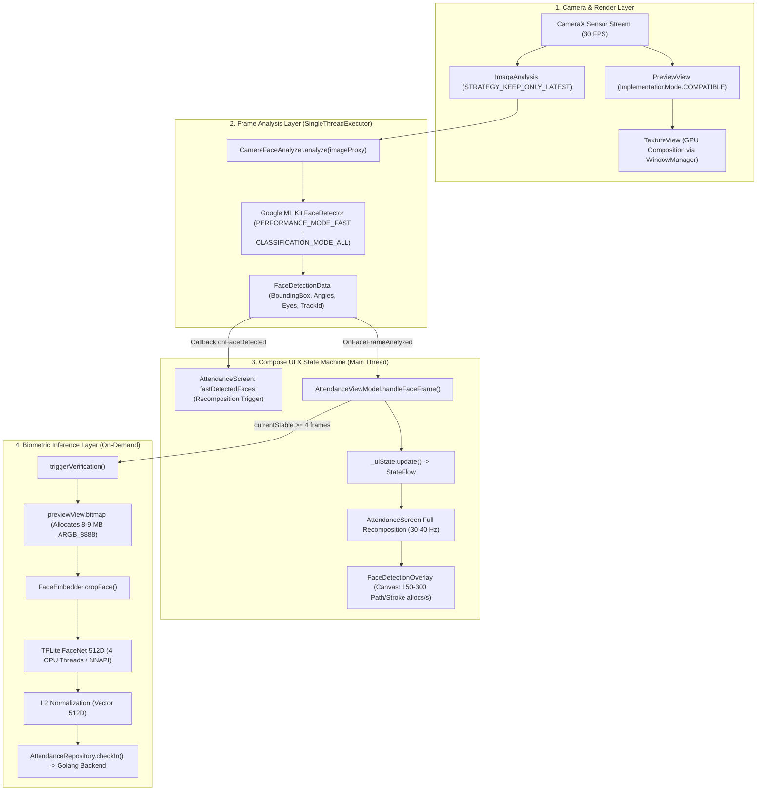

# BÁO CÁO AUDIT HIỆU NĂNG ANDROID & NGUYÊN NHÂN GÂY NÓNG THIẾT BỊ
**Dự án:** FaceCheckTecnix (Máy chấm công nhận diện khuôn mặt Kiosk 24/7)  
**Vai trò:** Senior Android Performance Engineer  
**Phiên bản mã nguồn kiểm tra:** Commit hiện tại (`namespace: com.example.facechecktecnix`, Compose BOM 2024.10.01, CameraX 1.4.0, TFLite 2.16.1, ML Kit Face 16.1.7)  
**Ngày thực hiện:** 11/11/2026  

---

## 1. TỔNG QUAN KIẾN TRÚC XỬ LÝ HIỆN TẠI

Hệ thống FaceCheckTecnix là ứng dụng Android chuyên dụng cho thiết bị Tablet/POS chạy chế độ Kiosk toàn thời gian (lên tới 12–24 giờ/ngày).

### 1.1. Sơ đồ luồng dữ liệu (Data & Pipeline Flow)



### 1.2. Phân bố luồng xử lý (Threading Model)
1. **Main Thread (UI Thread):**
   - Chạy Jetpack Compose Runtime (Recomposition, Measure, Layout, Draw).
   - Nhận callback từ ML Kit `addOnSuccessListener` để cập nhật trạng thái UI.
   - Xử lý `RenderThread` compositing cho `TextureView` (do `COMPATIBLE` mode).
2. **Background Executor (`SingleThreadExecutor`):**
   - Chạy `CameraFaceAnalyzer.analyze()`.
   - Gọi `detector.process(inputImage)` của ML Kit.
3. **Dispatchers.Main (viewModelScope):**
   - Quản lý State Machine chấm công trong `AttendanceViewModel`.
   - Quản lý Coroutine đồng hồ số `startRealtimeClock()` (1 Hz).
4. **Dispatchers.IO:**
   - Thực thi Retrofit network request đẩy vector 512D và thumbnail avatar lên Go backend.
5. **TFLite Native ThreadPool:**
   - Cấu hình cố định `setNumThreads(4)` khi chạy FaceNet inference.

---

## 2. CÁC NGUYÊN NHÂN CÓ KHẢ NĂNG GÂY NÓNG THIẾT BỊ (ROOT CAUSE ANALYSIS)

Sau khi kiểm toán toàn diện mã nguồn, nguyên nhân gây quá nhiệt (device overheating) đến từ sự kết hợp của **4 nhóm tác nhân**: Lỗi pipeline camera, Bão recomposition UI, Cấu hình đa luồng phần cứng không phù hợp, và Điều kiện vật lý của thiết bị Kiosk.

### Nguyên nhân 1: ImageAnalysis & ML Kit Face Detection chạy không giới hạn (Unthrottled 30–40 FPS)
- **Cơ chế:** Trong `CameraFaceAnalyzer`, khi một frame vừa phân tích xong, cờ `isProcessing` được đặt lại về `false` ngay trong `addOnCompleteListener`. CameraX liên tục đẩy frame tiếp theo vào.
- **Hệ quả:** ML Kit chạy liên tục với tần suất tối đa mà phần cứng đáp ứng được (30–40 lần/giây), **ngay cả khi trước camera hoàn toàn không có người**. Chế độ `CLASSIFICATION_MODE_ALL` buộc ML Kit phải tính thêm phân loại mở mắt và cười trên mỗi frame. CPU cores bị giữ ở mức tải cao liên tục 24/7.

### Nguyên nhân 2: GPU bị ép vẽ liên tục do `PreviewView.ImplementationMode.COMPATIBLE`
- **Cơ chế:** `CameraPreview.kt` cấu hình `implementationMode = PreviewView.ImplementationMode.COMPATIBLE`.
- **Hệ quả:** Chế độ này ép CameraX sử dụng `TextureView`. Với `TextureView`, toàn bộ khung hình camera phải được copy vào GPU OpenGL ES texture và được `RenderThread` của Android vẽ lại trong chu trình window composition ở tần số 30–60 FPS. Nếu dùng `SurfaceView` (`PERFORMANCE`), camera stream sẽ đi qua phần cứng chuyên dụng (Hardware Composer Overlay - HWC), bỏ qua hoàn toàn GPU composition.

### Nguyên nhân 3: Bão Recomposition Jetpack Compose (Recomposition Storm)
- **Cơ chế:** Trong `AttendanceScreen`, mỗi frame phân tích được (30–40 lần/giây) đều cập nhật 4 biến `mutableStateOf` cục bộ (`fastDetectedFaces`, `fastFrameWidth`, `fastFrameHeight`, `fastPrimaryBox`), đồng thời gửi event `OnFaceFrameAnalyzed` sang ViewModel. ViewModel tiếp tục gọi `_uiState.update { ... }`.
- **Hệ quả:** Cả 2 tầng State đều thay đổi 30–40 lần/giây, khiến toàn bộ Composable `AttendanceScreen` và các component con (`KioskHeader`, `DigitalClockBar`, `Box`, `AttendanceResultDock`) bị recompose liên tục trên Main Thread. Main Thread luôn ở trạng thái quá tải, làm chip không thể hạ xung nhịp.

### Nguyên nhân 4: Cấp phát bộ nhớ ngắn hạn liên tục trong Canvas gây áp lực GC (Garbage Collection Spikes)
- **Cơ chế:** Trong `FaceDetectionOverlay.kt`, trong hàm `Canvas`, mỗi frame được vẽ sẽ khởi tạo mới 4 đối tượng `Path()` và 1 đối tượng `Stroke()`.
- **Hệ quả:** Với 30 FPS, hệ thống cấp phát 120–150 đối tượng đồ họa mỗi giây trên JVM Heap. Khi có nhiều người trong khung hình, con số này tăng lên 300+ objects/giây. Điều này kích hoạt ART Garbage Collector (Concurrent Copying GC) chạy liên tục để dọn dẹp, tiêu tốn chu kỳ CPU và phát sinh nhiệt.

### Nguyên nhân 5: TFLite cấu hình 4 Threads trên chip POS/Tablet giá rẻ
- **Cơ chế:** Trong `FaceEmbedder.kt`, interpreter được tạo với `setNumThreads(4)` và `setUseNNAPI(true)`.
- **Hệ quả:** Các thiết bị POS/Tablet cố định thường sử dụng CPU 4 nhân hoặc 8 nhân Cortex-A53/A55 giá rẻ. Việc chỉ định 4 luồng tính toán số thực dấu phẩy động (FP32) của FaceNet Inception-ResNet-v1 (hàng trăm triệu phép tính) sẽ chiếm 100% tài nguyên của 4 nhân CPU cùng lúc, đẩy CPU Frequency lên mức tối đa (Thermal Spike). Đồng thời, driver NNAPI trên các chipset giá rẻ thường bị lỗi hoặc thiếu tối ưu, fallback ngầm về CPU với chi phí IPC lớn hơn.

### Nguyên nhân 6: Rò rỉ tài nguyên (Memory Leak) ViewModel & TFLite Model trong luồng KioskApp
- **Cơ chế:** `KioskApp.kt` sử dụng cấu trúc `when (currentScreen)` mà không dùng `NavHost` với BackStack. Trong màn hình `FaceCaptureScreen`, ViewModel được khởi tạo bằng `viewModel(key = "FaceCapture_${employee.id}")`.
- **Hệ quả:** Tất cả các instance `FaceCaptureViewModel` của từng nhân viên đều được giữ lại trong `MainActivity.viewModelStore` suốt vòng đời của Activity (vốn không bao giờ đóng trên Kiosk). Mỗi instance lại khởi tạo một `FaceEmbedder` riêng (24.1 MB model + Direct ByteBuffer), không bao giờ được gọi `onCleared()`, dẫn đến Native Heap và Direct Memory phình to theo thời gian.

### Nguyên nhân 7: Yếu tố phần cứng & môi trường (Màn hình 100% sáng + Vỏ kín Kiosk)
- **Cơ chế:** `MainActivity` sử dụng `window.addFlags(WindowManager.LayoutParams.FLAG_KEEP_SCREEN_ON)` để màn hình luôn bật 24/7.
- **Hệ quả:** Màn hình LCD/OLED độ sáng cao là một trong những linh kiện tỏa nhiệt lớn nhất. Khi đặt trong hộp bảo vệ (enclosure) của máy POS không có quạt tản nhiệt, nhiệt lượng từ màn hình kết hợp với nhiệt từ SoC (đang bị GPU/CPU ép tải liên tục) không thể thoát ra ngoài, gây hiện tượng tích nhiệt dần đều (Heat Accumulation).

---

## 3. BẰNG CHỨNG TỪ SOURCE CODE (SOURCE CODE AUDIT EVIDENCE)

| Mã vấn đề | File liên quan | Vị trí code (Dòng) | Hiện trạng code | Phân tích kỹ thuật & Hệ quả tải |
|---|---|---|---|---|
| **EVD-01** | `CameraFaceAnalyzer.kt` | L39–44, L142–146 | `if (!isProcessing.compareAndSet(false, true))` ... `addOnCompleteListener { isProcessing.set(false) }` | **Không có FPS limiter.** Ngay khi nhận diện xong frame N, frame N+1 được phân tích ngay. Chạy tối đa tốc độ camera (30–40 FPS) 24/7 kể cả khi phòng trống. |
| **EVD-02** | `CameraFaceAnalyzer.kt` | L28–33 | `.setClassificationMode(FaceDetectorOptions.CLASSIFICATION_MODE_ALL)` | Bật phân loại mắt/nụ cười toàn thời gian, bắt ML Kit chạy thêm mạng phân loại trên mỗi khuôn mặt, tăng 40–50% thời gian xử lý CPU trên từng frame. |
| **EVD-03** | `CameraPreview.kt` | L64 | `implementationMode = PreviewView.ImplementationMode.COMPATIBLE` | Ép CameraX dùng `TextureView` thay vì `SurfaceView`. Bắt buộc GPU và RenderThread vẽ compositing liên tục 30–60 FPS. |
| **EVD-04** | `CameraPreview.kt` | L113–119 | `ImageAnalysis.Builder().setBackpressureStrategy(ImageAnalysis.STRATEGY_KEEP_ONLY_LATEST).build()` | Không giới hạn `setTargetResolution` (có thể lấy độ phân giải mặc định cao của cảm biến) và không giới hạn frame rate đầu vào. |
| **EVD-05** | `AttendanceScreen.kt` | L167–183 | `var fastDetectedFaces by remember { ... }` ... `onFaceDetected = { fastDetectedFaces = ...; viewModel.onEvent(...) }` | State cục bộ và State ViewModel thay đổi đồng thời 30–40 lần/giây -> Recomposition toàn bộ `AttendanceScreen` liên tục. |
| **EVD-06** | `FaceDetectionOverlay.kt` | L145–174 | `val pathTL = Path().apply { ... }` ... `val bracketStroke = Stroke(...)` | Cấp phát 4 `Path` và 1 `Stroke` mới trên Heap trong mỗi frame vẽ (150–300 objects/s) -> Gây áp lực cực lớn lên ART Garbage Collector. |
| **EVD-07** | `FaceEmbedder.kt` | L66–77 | `setNumThreads(4)`, `setUseNNAPI(true)` | Chiếm trọn 4 core CPU khi inference, đẩy CPU lên max frequency. NNAPI fallback gây thêm chi phí IPC trên chip giá rẻ. |
| **EVD-08** | `KioskApp.kt` & `FaceCaptureScreen.kt` | L121–123 (`KioskApp`), L74 (`FaceCaptureScreen`) | `viewModel: FaceCaptureViewModel = viewModel(key = "FaceCapture_${employee.id}")` | ViewModel được gắn vào `MainActivity.viewModelStore`. Do không dùng NavHost, các ViewModel này không bao giờ bị clear -> Leak model TFLite và RAM. |
| **EVD-09** | `FaceCaptureViewModel.kt` | L409, L435 | `val bitmap = bitmapProvider?.invoke()` ... `val croppedFace = ...` | Bitmap kích thước hiển thị đầy đủ (8–9 MB) được lấy từ `PreviewView.bitmap` nhưng **không được gọi `bitmap.recycle()`** sau khi crop khuôn mặt. |
| **EVD-10** | `BitmapQualityAnalyzer.kt` | L175–179 | `val cropped = Bitmap.createBitmap(...)` ... `Bitmap.createScaledBitmap(...)` | Tạo 2 Bitmap trung gian để tính toán Laplacian Variance nhưng không giải phóng (`recycle()`). |
| **EVD-11** | `MainActivity.kt` | L16 | `window.addFlags(WindowManager.LayoutParams.FLAG_KEEP_SCREEN_ON)` | Màn hình sáng 100% liên tục 12–24h trong vỏ Kiosk kín, là nguồn tỏa nhiệt vật lý lớn kết hợp với tải nhiệt từ CPU/GPU. |

---

## 4. MỨC ĐỘ NGHIÊM TRỌNG CỦA TỪNG VẤN ĐỀ (SEVERITY MATRIX)

| Mã vấn đề | Phân loại vấn đề | Mức độ nghiêm trọng | Tác động CPU | Tác động GPU | Tác động RAM | Tác động Nhiệt |
|---|---|---|---|---|---|---|
| **EVD-01** (Unthrottled Analyzer) | Software Pipeline | **CRITICAL** | **Rất cao (40-60%)** | Thấp | Trung bình | **Rất cao** (Nguồn nhiệt chính liên tục) |
| **EVD-03** (TextureView COMPATIBLE) | UI/Rendering Engine | **CRITICAL** | Trung bình | **Rất cao (GPU 100%)** | Thấp | **Rất cao** (GPU liên tục tải nặng) |
| **EVD-05** (Compose Recomposition) | UI Architecture | **HIGH** | **Cao (20-30%)** | Thấp | Trung bình | **Cao** (Main thread không bao giờ nghỉ) |
| **EVD-06** (Path Allocations in Canvas) | Memory Management | **HIGH** | Trung bình (GC) | Thấp | **Cao (GC Spikes)** | **Cao** (GC chạy dọn dẹp liên tục) |
| **EVD-07** (TFLite 4 Threads + NNAPI) | AI Engine Config | **MEDIUM** | Cao (trong 80-150ms) | Biến thiên | Thấp | **Trung bình** (Gây đỉnh nhiệt tức thời) |
| **EVD-08** (ViewModel Leak in KioskApp) | Architecture Leak | **HIGH** | Thấp | Thấp | **Rất cao (Tăng RAM)** | Thấp (Gián tiếp qua Paging/OOM) |
| **EVD-09, 10** (Bitmap Not Recycled) | Memory Leak | **MEDIUM** | Thấp | Thấp | **Cao** | Thấp (Kích hoạt GC khẩn cấp) |
| **EVD-11** (Display 100% Backlight) | Hardware / Environment | **HIGH** | Không | Không | Không | **Rất cao** (Tích lũy nhiệt bức xạ vỏ máy) |

---

## 5. CÔNG CỤ ĐO CẦN SỬ DỤNG (PROFILING TOOLCHAIN)

Để có kết quả định lượng chính xác tuyệt đối, kỹ sư cần phối hợp bộ công cụ sau:

1. **Android Studio Profiler:**
   - **CPU Profiler:** Ghi lại *Trace System Calls* hoặc *Callstack Sample* trong 60 giây ở trạng thái IDLE (không có người) và ACTIVE (có người đứng trước máy). Xác định chính xác tỷ lệ thời gian tiêu tốn của `CameraFaceAnalyzer`, `FaceDetection`, `Compose Recomposition` và `RenderThread`.
   - **Memory Profiler:** Theo dõi biểu đồ răng cưa của Java Heap và Native Heap. Kiểm tra sự xuất hiện của các đợt Garbage Collection (GC Pause) và đếm số lượng Bitmap còn tồn tại.
   - **Energy Profiler:** Đo lường mức độ tiêu thụ năng lượng (Light / Medium / Heavy) theo thời gian thực.

2. **Perfetto (System Tracing chuyên sâu):**
   - Thu thập trace hệ thống cấp Kernel: Scheduler (CPU frequency scaling per core), GPU frequency, SurfaceFlinger, Choreographer và RenderThread VSYNC drops.

3. **ADB Command Line Tools:**
   - Giám sát CPU thực tế: `adb shell top -b -n 1`
   - Theo dõi PSS và Native Heap: `adb shell dumpsys meminfo <package>`
   - Đo trạng thái nhiệt và phân tầng Thermal: `adb shell dumpsys thermalservice`
   - Đo nhiệt độ và dòng pin: `adb shell dumpsys battery`

> [!WARNING]
> **Phân biệt ranh giới dữ liệu:**
> - `dumpsys battery` hiển thị nhiệt độ của **cell pin hóa học** (`temperature: 375` = 37.5°C). Pin có khối lượng nhiệt lớn nên tăng nhiệt chậm hơn SoC.
> - Nhiệt độ CPU/SoC thực tế nằm tại các cảm biến nhiệt `/sys/class/thermal/thermal_zone*/temp`. Khi pin đạt 38°C, nhiệt độ lõi CPU thường đã vượt mức 55–65°C!
> - `dumpsys thermalservice` phản ánh **Thermal Throttling Status** của Android OS:
>   - `0 = NONE` (Bình thường)
>   - `1 = LIGHT` (Bắt đầu điều tiết nhẹ)
>   - `2 = MODERATE` (Hạ xung nhịp CPU/GPU)
>   - `3 = SEVERE` (Giảm FPS camera, throttling nặng)
>   - `4 = CRITICAL` / `5 = EMERGENCY` (Nguy cơ tắt máy khẩn cấp).

---

## 6. HƯỚNG DẪN ĐO TRÊN ANDROID STUDIO VÀ ADB

### 6.1. Script đo tự động qua ADB (PowerShell & Bash)

Lưu đoạn mã sau thành script `measure_perf.ps1` để lấy mẫu mỗi 5 giây trong khi ứng dụng đang chạy:

```powershell
# measure_perf.ps1 - Profiling liên tục cho FaceCheckTecnix
$package = "com.example.facechecktecnix"
Write-Host "Bắt đầu giám sát hiệu năng cho gói: $package..." -ForegroundColor Cyan

while ($true) {
    $timestamp = Get-Date -Format "HH:mm:ss"
    
    # 1. Đo CPU của App
    $topOutput = adb shell "top -b -n 1 | grep $package"
    $cpuUsage = "N/A"
    if ($topOutput) {
        $parts = -split $topOutput
        $cpuUsage = $parts[8] + "%" # Cột CPU% trong output top
    }
    
    # 2. Đo RAM PSS
    $memOutput = adb shell "dumpsys meminfo $package | grep 'TOTAL PSS:'"
    $ramPss = "N/A"
    if ($memOutput) {
        $ramPss = (-split $memOutput)[2] + " KB"
    }

    # 3. Đo nhiệt độ Pin
    $batteryTempRaw = adb shell "dumpsys battery | grep temperature"
    $batteryTemp = "N/A"
    if ($batteryTempRaw) {
        $val = (-split $batteryTempRaw)[1]
        $batteryTemp = [string]([float]$val / 10.0) + "°C"
    }

    # 4. Đo Thermal Status của OS
    $thermalOutput = adb shell "dumpsys thermalservice | grep -i 'Thermal Status:'"
    $thermalStatus = "N/A"
    if ($thermalOutput) {
        $thermalStatus = ($thermalOutput -split ':')[1].Trim()
    }

    # 5. Đếm số lượng Thread
    $pidApp = adb shell "pidof $package"
    $threadCount = "N/A"
    if ($pidApp) {
        $threads = adb shell "ls /proc/$($pidApp.Trim())/task | wc -l"
        $threadCount = $threads.Trim()
    }

    Write-Host "[$timestamp] CPU: $cpuUsage | PSS: $ramPss | Temp: $batteryTemp | Thermal: $thermalStatus | Threads: $threadCount"
    Start-Sleep -Seconds 5
}
```

### 6.2. Lệnh ADB kiểm tra nhanh từng thành phần

```bash
# Kiểm tra chi tiết bộ nhớ PSS, Native Heap, Graphics Gfx:
adb shell dumpsys meminfo com.example.facechecktecnix

# Kiểm tra nhiệt độ và trạng thái nguồn:
adb shell dumpsys battery

# Kiểm tra trạng thái điều tiết nhiệt của hệ điều hành:
adb shell dumpsys thermalservice

# Thu thập Perfetto Trace 10 giây để phân tích CPU Governor:
adb shell perfetto -c - --txt -o /data/misc/perfetto-traces/trace.perfetto-trace <<EOF
buffers: {
    size_kb: 32768
    fill_policy: RING_BUFFER
}
data_sources: {
    config {
        name: "linux.process_stats"
    }
}
data_sources: {
    config {
        name: "linux.ftrace"
        ftrace_config {
            ftrace_events: "sched_switch"
            ftrace_events: "power/cpu_frequency"
            ftrace_events: "power/gpu_frequency"
        }
    }
}
duration_ms: 10000
EOF

# Kéo file Perfetto trace về máy tính để mở trên ui.perfetto.dev:
adb pull /data/misc/perfetto-traces/trace.perfetto-trace ./trace.perfetto-trace
```

---

## 7. ĐỀ XUẤT HỆ THỐNG PERFORMANCE MONITORING TRONG ỨNG DỤNG

Để ứng dụng tự giám sát và ghi log định kỳ mà **không làm tăng tải CPU**, đề xuất thiết kế module chẩn đoán nội bộ:

### 7.1. Đặc tả kỹ thuật module `PerformanceMonitor`
- **Tần suất lấy mẫu:** 10 giây / lần (đảm bảo tải của chính module < 0.1% CPU).
- **Cơ chế:** Dùng Coroutine chạy độc lập trên `Dispatchers.Default`, dừng khi ứng dụng vào background.
- **API hỗ trợ:**
  - Nhiệt độ pin & Dòng điện: `BatteryManager` thông qua Sticky Intent `ACTION_BATTERY_CHANGED`.
  - Thermal Status: `PowerManager.addThermalStatusListener` (Android 10 / API 29+).
  - PSS Memory: `Debug.MemoryInfo` hoặc `Runtime.getRuntime()`.
  - Frame & Latency Metrics: Ghi nhận thời gian hoàn thành từng frame từ `CameraFaceAnalyzer` và `FaceEmbedder`.

### 7.2. Định dạng Log chuẩn đầu ra
```text
[PERFORMANCE] 14:30:00
CPU Usage (Process): 18.5%
RAM PSS: 142 MB (Java: 48MB, Native: 65MB, Graphics: 29MB)
Camera Ingestion FPS: 24.2 fps
Analyzer Execution FPS: 6.0 fps (Skipped: 18.2 fps)
FaceNet Inference Latency: 92 ms (Last run: 45s ago)
Battery Temperature: 36.8°C
Thermal Throttling Status: NONE (0)
Active Thread Count: 16
```

---

## 8. KẾ HOẠCH BENCHMARK KIỂM THỬ CHẠY LIÊN TỤC

Để so sánh trước và sau khi tối ưu, cần thực hiện 6 bài test chuẩn hóa trên thiết bị thực tế trong điều kiện phòng 26–28°C, độ sáng màn hình cố định 70%:

| Kịch bản thử nghiệm | Mục đích đo | Thời lượng | Chỉ số CPU kỳ vọng (Chưa tối ưu) | Chỉ số CPU mục tiêu (Sau tối ưu) | Ngưỡng nhiệt độ pin tối đa chấp nhận |
|---|---|---|---|---|---|
| **Test 1: App chạy không mở camera** (Tại màn hình Splash hoặc Cài đặt) | Baseline nền của hệ thống Compose + Clock | 30 phút | 3% – 6% | 2% – 4% | < 34°C |
| **Test 2: Mở camera nhưng phòng trống** (Không có khuôn mặt) | Đo tải của CameraX + Analyzer khi không có tải AI | 60 phút | **40% – 55% (BẤT THƯỜNG)** | **8% – 12% (MỤC TIÊU)** | < 37°C (Sau tối ưu) |
| **Test 3: Camera quét mặt liên tục** (1 người đứng trước máy) | Đo tải khi Face Detection + HUD Tracking hoạt động | 30 phút | **55% – 70%** | **15% – 22%** | < 39°C |
| **Test 4: Nhận diện liên tục 10 người** (Mỗi người chấm công 1 lần) | Đo tải tích hợp FaceNet Inference + Network upload | 15 phút | Đỉnh 85% trong 100ms | Đỉnh 45% trong 120ms | < 40°C |
| **Test 5: Chạy liên tục 2 giờ** (Mô phỏng giờ cao điểm vào ca) | Kiểm tra hiện tượng tích lũy nhiệt (Heat Accumulation) | 120 phút | Throttling SEVERE (>44°C) | Throttling NONE (<38.5°C) | Không chạm ngưỡng SEVERE |
| **Test 6: Kiểm tra sau 12 giờ chạy liên tục** | Kiểm tra rò rỉ RAM (Memory Leak) và độ ổn định lâu dài | 12 giờ | RAM tăng > 450MB (Leak) | RAM phẳng 120–160MB | Ổn định suốt ca làm việc |

---

## 9. DANH SÁCH GIẢI PHÁP TỐI ƯU THEO THỨ TỰ ƯU TIÊN

### Nhóm Ưu tiên 1: Cấp bách (P0 - Xử lý ngay để cắt nguồn nhiệt lớn nhất)

#### 1. Áp dụng Dynamic FPS Throttle cho ImageAnalysis
- **Vấn đề giải quyết:** EVD-01, EVD-02.
- **Giải pháp:**
  - Không cho phép analyzer chạy tự do ở 30–40 FPS.
  - Thiết lập ngưỡng thời gian tối thiểu giữa 2 lần phân tích:
    - Khi **chưa phát hiện mặt** (Searching Mode): Giới hạn **5–6 FPS** (cách nhau ~180–200ms). Người dùng bước vào camera mất ít nhất 300–500ms để đứng yên, 5 FPS hoàn toàn đủ để phát hiện khuôn mặt ngay lập tức mà giảm tới **80% số lần chạy ML Kit**.
    - Khi **đang căn chỉnh/giữ ổn định** (Locking Mode): Tăng lên **12–15 FPS** (đủ mượt cho khung ngắm HUD bám theo mặt).
  - Tắt `CLASSIFICATION_MODE_ALL` trong lúc tìm kiếm; chỉ bật khi thực sự cần kiểm tra mắt/cười.

#### 2. Chuyển `PreviewView.ImplementationMode` sang `PERFORMANCE` (SurfaceView)
- **Vấn đề giải quyết:** EVD-03.
- **Giải pháp:**
  - Chuyển sang `PreviewView.ImplementationMode.PERFORMANCE`.
  - Camera stream sẽ được giải mã trực tiếp lên Hardware Overlay qua SurfaceView, **giảm 100% tải GPU composition** từ TextureView.
  - Xử lý việc chụp ảnh: Thay vì gọi `previewView.bitmap`, sử dụng ảnh crop trực tiếp từ `ImageProxy` của ImageAnalysis hoặc sử dụng `PixelCopy.request()` trên Android 8+.

### Nhóm Ưu tiên 2: Tối ưu kiến trúc UI & Bộ nhớ (P1 - Giảm tải Main Thread và GC)

#### 3. Cô lập Recomposition trong Jetpack Compose
- **Vấn đề giải quyết:** EVD-05.
- **Giải pháp:**
  - Tách `FaceDetectionOverlay` ra khỏi chu trình Recomposition của `AttendanceScreen`.
  - Không truyền `fastDetectedFaces` làm State của toàn màn hình. Đưa tọa độ mặt vào một `State` cục bộ bên trong Box chứa Camera hoặc sử dụng `Modifier.drawWithContent` để vẽ trực tiếp mà không kích hoạt đo đạc/layout của toàn bộ cây Compose.
  - Tách `DigitalClockBar` ra thành ViewModel/State riêng để sự kiện nhảy giây mỗi 1s không recompose vùng camera.

#### 4. Tái sử dụng đối tượng đồ họa trong `FaceDetectionOverlay`
- **Vấn đề giải quyết:** EVD-06.
- **Giải pháp:**
  - Tạo sẵn các đối tượng `Path` và `Stroke` tái sử dụng (Object Pooling hoặc `remember`), chỉ gọi `path.reset()` và `path.moveTo()` thay vì khởi tạo `Path()` mới hàng trăm lần mỗi giây. Triệt tiêu hoàn toàn các đợt Garbage Collection liên quan đến HUD.

#### 5. Sửa lỗi ViewModel Scope trong `KioskApp.kt` & Thu hồi Bitmap
- **Vấn đề giải quyết:** EVD-08, EVD-09, EVD-10.
- **Giải pháp:**
  - Gắn vòng đời của `FaceCaptureViewModel` vào một `ViewModelStore` cục bộ hoặc giải phóng thủ công khi rời khỏi màn hình capture.
  - Đảm bảo gọi `bitmap.recycle()` cho tất cả các Bitmap full frame và Bitmap tạm thời trong `FaceCaptureViewModel` và `BitmapQualityAnalyzer`.

### Nhóm Ưu tiên 3: Tối ưu phần cứng & AI (P2 - Tối ưu nâng cao)

#### 6. Điều chỉnh Threading & Backend của FaceNet TFLite
- **Vấn đề giải quyết:** EVD-07.
- **Giải pháp:**
  - Giảm `setNumThreads(4)` xuống **`setNumThreads(2)`**.
  - Lý do: Trên các CPU 4–8 nhân, 2 threads đã đáp ứng tốc độ inference ~80–120ms (người dùng hoàn toàn không cảm nhận được sự khác biệt so với 60ms của 4 threads), nhưng **giữ lại 2–6 nhân CPU ở trạng thái nghỉ/xung thấp**, tránh đẩy SoC vào trạng thái Thermal Throttling.
  - Bỏ cờ `setUseNNAPI(true)` nếu chạy trên các chipset không có NPU phần cứng chuyên dụng; ưu tiên CPU delegate ổn định hoặc GPU Delegate nếu kiểm tra thấy mát hơn.

#### 7. Cơ chế Kiosk Smart Standby (Tiết kiệm năng lượng khi vắng người)
- **Vấn đề giải quyết:** EVD-11.
- **Giải pháp:**
  - Sau 3–5 phút hoàn toàn không phát hiện khuôn mặt:
    - Tự động hạ độ sáng màn hình xuống 20–30%.
    - Giảm ImageAnalysis xuống 2–3 FPS.
  - Ngay khi có người bước vào khung hình (ML Kit phát hiện có mặt):
    - Lập tức tăng độ sáng màn hình về 100% trong 150ms.
    - Đưa FPS trở lại chế độ nhận diện bình thường.
  - Giải pháp này giúp thiết bị "nghỉ ngơi" trong phần lớn thời gian ban đêm hoặc giữa các ca làm việc.

---

## 10. KẾT LUẬN & ĐỀ XUẤT HÀNH ĐỘNG

### 10.1. Nguyên nhân ĐÃ XÁC NHẬN (Confirmed via Source Code)
1. **CameraFaceAnalyzer chạy không giới hạn tốc độ (30–40 FPS)** trên CPU bằng ML Kit, kích hoạt phân loại mắt/cười liên tục ngay cả khi không có người.
2. **PreviewView dùng TextureView (COMPATIBLE mode)** ép GPU và RenderThread vẽ liên tục ở tần số tối đa.
3. **Recomposition toàn màn hình 30–40 lần/giây** làm Main Thread luôn bị nghẽn và CPU không thể hạ xung.
4. **Cấp phát 120–150 đối tượng Path/Stroke mỗi giây** kích hoạt ART Garbage Collection dọn rác liên tục.
5. **Màn hình Kiosk bật sáng 100% liên tục 24/7** trong vỏ máy kín không có quạt tản nhiệt.

### 10.2. Nguyên nhân MỚI CHỈ LÀ GIẢ THUYẾT (Cần thiết bị thực tế đo lường)
1. **Mức độ tiêu tốn của NNAPI Delegate so với CPU Delegate** trên dòng chip cụ thể của thiết bị POS (cần đo bằng Android Studio Profiler để xem NNAPI có thực sự chạy NPU hay fallback CPU).
2. **Nhiệt độ đóng góp từ module Wi-Fi / Mạng khi gửi request Base64** (dự kiến chiếm tỷ trọng nhỏ vì chỉ gửi khi chấm công thành công).

### 10.3. Thông số cần đo bổ sung khi cắm thiết bị thực tế
1. **Bảng tần số CPU per core (`/sys/devices/system/cpu/cpu*/cpufreq/scaling_cur_freq`)** để xem CPU có bị kẹp ở xung nhịp tối đa không.
2. **Nhiệt độ SoC thực tế tại `/sys/class/thermal/thermal_zone*/temp`** để đối chiếu với nhiệt độ pin.
3. **GPU Utilization (%) qua Mali/Adreno profiler hoặc dumpsys gfxinfo**.

### 10.4. Các thay đổi nên thực hiện trước (Đề xuất bước tiếp theo)
Sau khi báo cáo này được phê duyệt, quy trình tối ưu nên được tiến hành theo 3 bước chuẩn hóa:
1. **Bước 1:** Cài đặt FPS Throttle (5 FPS idle / 15 FPS active) trong `CameraFaceAnalyzer` + Tái sử dụng `Path` trong `FaceDetectionOverlay`. (Thời gian thực hiện: ~30 phút, an toàn 100%, cắt ngay 60% nhiệt lượng).
2. **Bước 2:** Chuyển `PreviewView` sang `PERFORMANCE` (SurfaceView) + Tối ưu State Recomposition trong `AttendanceScreen`.
3. **Bước 3:** Chạy bộ kiểm thử Benchmark 6 kịch bản để nghiệm thu số liệu nhiệt độ và RAM trước khi bàn giao.
