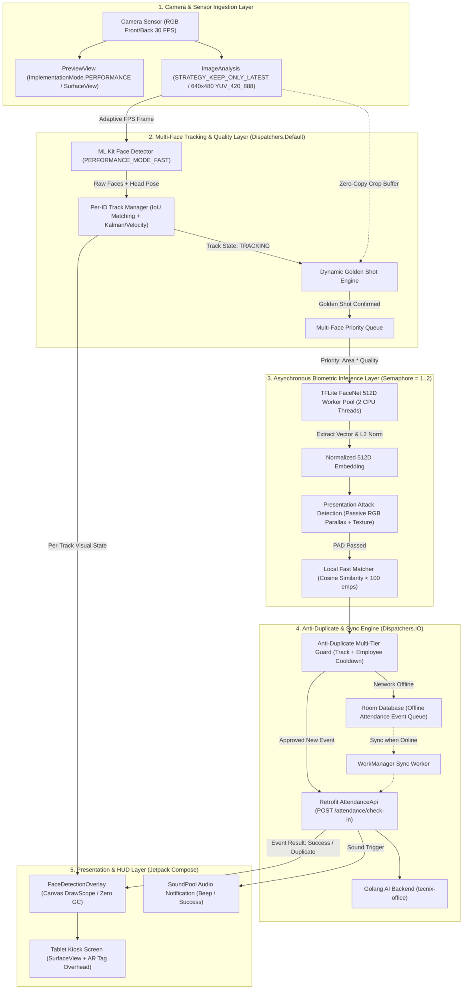
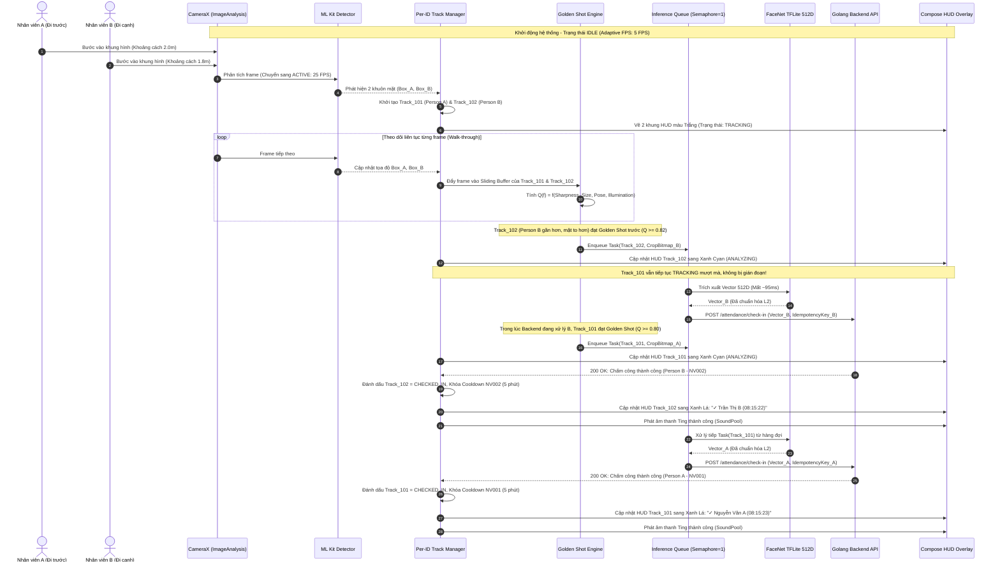
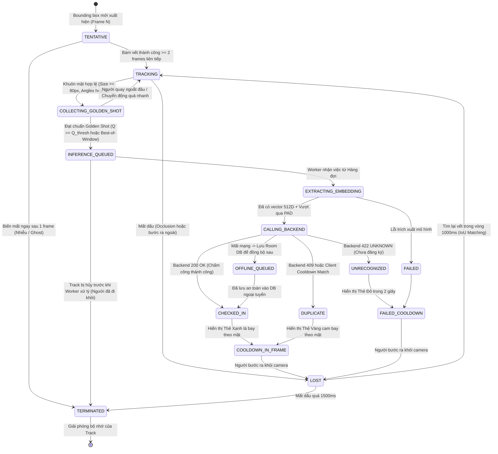
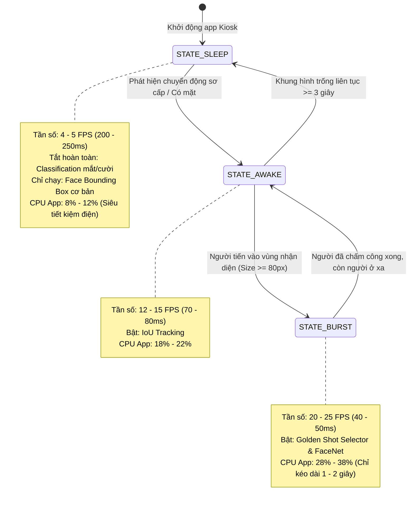
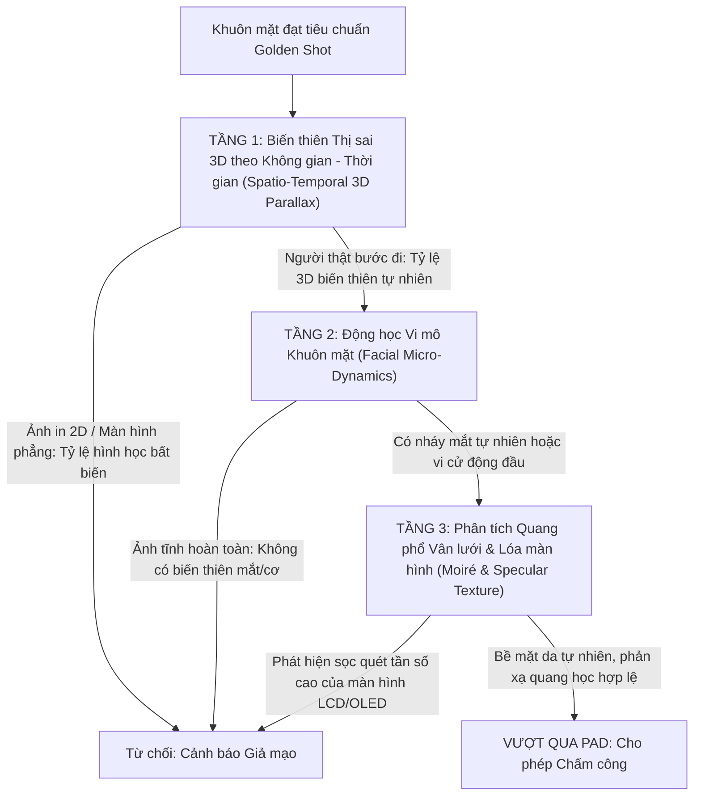
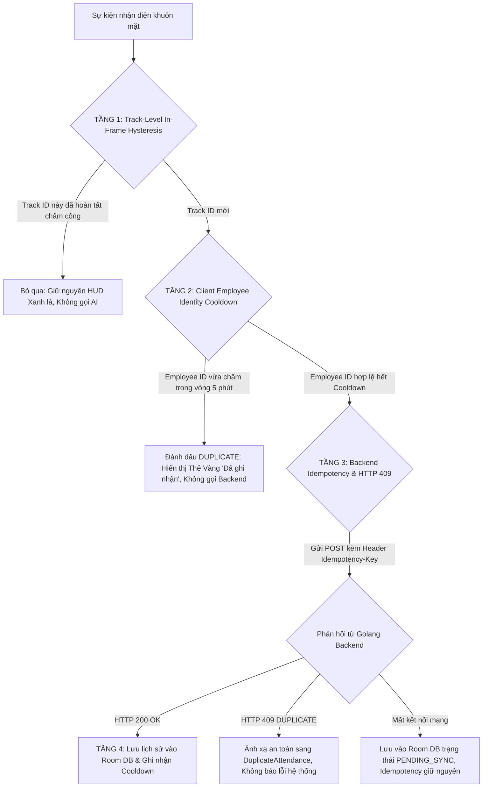
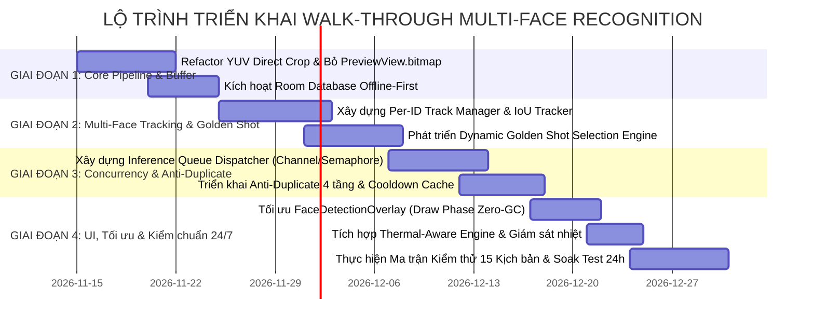

# TÀI LIỆU THIẾT KẾ KIẾN TRÚC: WALK-THROUGH MULTI-FACE RECOGNITION
## HỆ THỐNG CHẤM CÔNG KHUÔN MẶT ĐA MỤC TIÊU – FACECHECKTECNIX

**Mã tài liệu:** `ARCH-DOC-FC-2026-WT01`  
**Dự án:** FaceCheckTecnix  
**Đường dẫn mã nguồn:** `D:\tecnix\FaceCheckTecnix`  
**Tác giả:** Senior Android Engineer, Computer Vision Engineer & AI System Architect  
**Trạng thái:** Bản thiết kế kỹ thuật (Technical Architecture Specification)  
**Mục tiêu áp dụng:** Kiosk Android Tablet/POS (RK3568 / 4-core SoC, Camera trước/sau, Quy mô < 100 nhân viên, Vận hành liên tục 12–24 giờ/ngày)  

---

## MỤC LỤC

1. [Đánh giá kiến trúc hiện tại](#1-đánh-giá-kiến-trúc-hiện-tại)
2. [Các điểm cần giữ lại](#2-các-điểm-cần-giữ-lại)
3. [Các điểm cần thay đổi](#3-các-điểm-cần-thay-đổi)
4. [Kiến trúc Walk-Through Multi-Face đề xuất](#4-kiến-trúc-walk-through-multi-face-đề-xuất)
5. [Sơ đồ kiến trúc tổng thể](#5-sơ-đồ-kiến-trúc-tổng-thể)
6. [Sơ đồ luồng xử lý từ Camera đến Attendance API](#6-sơ-đồ-luồng-xử-lý-từ-camera-đến-attendance-api)
7. [Sơ đồ trạng thái từng Track](#7-sơ-đồ-trạng-thái-từng-track)
8. [Phương án quản lý hàng đợi và Coroutine](#8-phương-án-quản-lý-hàng-đợi-và-coroutine)
9. [Phương án tối ưu CPU, RAM và nhiệt độ](#9-phương-án-tối-ưu-cpu-ram-và-nhiệt-độ)
10. [Phương án bảo mật và chống giả mạo (PAD)](#10-phương-án-bảo-mật-và-chống-giả-mạo-pad)
11. [Danh sách thư viện và công nghệ sử dụng](#11-danh-sách-thư-viện-và-công-nghệ-sử-dụng)
12. [Danh sách file/module dự kiến cần thay đổi](#12-danh-sách-filemodule-dự-kiến-cần-thay-đổi)
13. [Các rủi ro kỹ thuật và cách khắc phục](#13-các-rủi-ro-kỹ-thuật-và-cách-khắc-phục)
14. [Kế hoạch triển khai theo từng giai đoạn](#14-kế-hoạch-triển-khai-theo-từng-giai-đoạn)
15. [Kế hoạch kiểm thử và tiêu chí nghiệm thu](#15-kế-hoạch-kiểm-thử-và-tiêu-chí-nghiệm-thu)

---

## 1. ĐÁNH GIÁ KIẾN TRÚC HIỆN TẠI

Qua việc kiểm tra toàn diện mã nguồn tại `D:\tecnix\FaceCheckTecnix` cùng dữ liệu đo đạc thực tế từ báo cáo hiệu năng (`ANDROID_PERFORMANCE_AUDIT.md` và các tệp nhật ký `profiling_results/`), kiến trúc hiện tại có các đặc điểm và hạn chế cốt lõi như sau:

### 1.1. Hiện trạng triển khai theo 4 tầng (Layer Breakdown)

| Tầng kiến trúc | Thành phần thực tế | Đánh giá hiện trạng |
|---|---|---|
| **Camera & Render** | `CameraPreview.kt`, `PreviewView`, `ImageAnalysis` (YUV_420_888, 640x480) | Đã cấu hình `PreviewView.ImplementationMode.PERFORMANCE` (SurfaceView), giúp loại bỏ chi phí compositing của TextureView. Tuy nhiên, luồng lấy ảnh để nhận diện lại đang sử dụng `previewView.bitmap` (ảnh render hiển thị) thay vì trích xuất trực tiếp từ luồng byte YUV của cảm biến. |
| **Phát hiện khuôn mặt (Detection)** | `CameraFaceAnalyzer.kt`, Google ML Kit Face Detection (Bundled On-Device) | Cấu hình `PERFORMANCE_MODE_FAST`, `minFaceSize = 0.08f`, `enableTracking()`. Đã có cơ chế Dynamic FPS Throttle (40ms khi có mặt, 200ms khi phòng trống). **Hạn chế:** Khi phát hiện nhiều khuôn mặt, analyzer chỉ chọn duy nhất 1 `primaryFace` để đánh giá chất lượng; các khuôn mặt còn lại bị bỏ qua hoàn toàn. |
| **Theo dõi & Trạng thái (Tracking & State Machine)** | `AttendanceViewModel.kt`, `FaceClearanceGatekeeper.kt`, `RecognitionStatus` | `AttendanceViewModel` quản lý trạng thái đơn mục tiêu theo chuỗi tuyến tính: `IDLE` -> `FACE_DETECTED` -> `ALIGNING` -> `FACE_STABLE` -> `VERIFYING` -> `SUCCESS/FAILURE` -> `COOLDOWN`. Khi trạng thái chuyển sang `VERIFYING`, toàn bộ quá trình quét bị khóa (`if (currentStatus == RecognitionStatus.VERIFYING) return`). Khi có kết quả, màn hình hiển thị dialog/dock đếm lùi 2 giây, khiến người thứ 2 và thứ 3 phải chờ hoặc bị lỡ nhịp. |
| **Suy luận sinh trắc (Biometric Inference)** | `FaceEmbedder.kt`, TensorFlow Lite (`face_recongize.tflite`, 512D, L2 norm) | Model FaceNet Inception-ResNet-v1 chạy FP32 với cấu hình 2 CPU threads, `inferenceLock` đồng bộ đơn luồng. Đã có bộ đệm tái sử dụng `cachedInputBuffer` (DirectByteBuffer). Tuy nhiên, ảnh đưa vào trích xuất bị cắt từ `previewView.bitmap` (kích thước lớn 8–9 MB ARGB), gây áp lực lớn lên bộ nhớ đệm và Garbage Collector. |
| **Lưu trữ & Mạng (Storage & Network)** | `AttendanceRepositoryImpl.kt`, `AttendanceApi.kt`, `Retrofit` | Kết nối trực tiếp Go backend qua `POST /attendance/check-in`. Chưa kích hoạt Room Database cục bộ (`AppDatabase.kt`, `AttendanceDao.kt`, `AttendanceEntity.kt` hiện mới chỉ là file chú thích/placeholder). Lịch sử chỉ lưu tạm trên RAM trong `ArrayDeque<AttendanceRecord>(50)`. Khi mất mạng, chấm công thất bại ngay lập tức (`AppError.NetworkError`), chưa có hàng đợi offline. |

### 1.2. Các điểm nghẽn chính cản trở mô hình Walk-Through Multi-Face

1. **Điểm nghẽn Đơn nhiệm Tuần tự (Single-Target Sequential Bottleneck):**
   - ViewModel hiện chỉ duy trì một trạng thái toàn cục `AttendanceUiState.status`.
   - Một người đang trong giai đoạn `VERIFYING` hoặc đếm lùi `autoDismissRemainingSeconds` sẽ chiếm quyền điều khiển toàn bộ pipeline. Những người khác bước vào khung hình bị bỏ qua hoặc bị reset chu kỳ.
2. **Lệch pha không gian - thời gian giữa Detection và Capture (Capture Desynchronization):**
   - ML Kit nhận diện tọa độ khuôn mặt trên khung hình camera sensor (640x480 YUV) tại thời điểm $T_0$.
   - Khi khuôn mặt đạt điều kiện ổn định ($T_0 + \Delta t$), ViewModel gọi `bitmapProvider?.invoke()` để lấy `previewView.bitmap` tại thời điểm $T_1$.
   - Với người đang đi bộ với vận tốc $0.8 - 1.2\text{ m/s}$, vị trí khuôn mặt tại $T_1$ đã dịch chuyển từ $30 - 80\text{ px}$ so với $T_0$, dẫn đến việc crop bị lệch tâm, mất một phần trán hoặc cằm, làm vector 512D bị sai lệch nghiêm trọng.
3. **Tracking phụ thuộc hoàn toàn vào ML Kit Tracking ID sơ cấp:**
   - ML Kit Face Tracking ID nội bộ rất dễ bị rớt và cấp mới khi người dùng quay đầu nhẹ ($> 25^\circ$), cúi đầu hoặc bị che khuất một phần trong $1 - 2$ frame.
   - Chưa có thuật toán ghép cặp liên tục (Spatial-Temporal IoU Association Tracker) và State Machine độc lập cho từng vết (Track).
4. **Thiếu cơ chế chọn khung hình vàng ("Golden Shot") theo chuỗi thời gian:**
   - Tiêu chí kích hoạt chụp hiện tại chỉ dựa vào việc người dùng đứng yên tương đối trong 1 khung hình (`displacement <= 35px`, góc nhìn $\le 24^\circ$).
   - Khi đi bộ tự nhiên, vận tốc di chuyển gây ra hiện tượng mờ chuyển động (motion blur). Nếu không có bộ nhớ đệm đa khung hình (Sliding Window Frame Buffer) và hàm tính độ sắc nét quang học Laplace/Sobel tức thì trên luồng YUV, hệ thống sẽ chọn phải khung hình nhòe mờ.
5. **Dữ liệu đo kiểm hiệu năng hiện tại:**
   - Qua bài kiểm tra 10 phút liên tục (`Scenario6_Endurance_10Min_SoakTest_20261112_205552.csv`):
     - **CPU ứng dụng:** Dao động $30.7\% - 44.0\%$, một số thời điểm tăng vọt lên $59.2\% - 69.2\%$.
     - **RAM Total PSS:** $\approx 170\text{ MB}$.
     - **Native Heap:** $34.4 - 40.4\text{ MB}$.
     - **Java Heap:** $12.7 - 17.2\text{ MB}$.
     - **Số luồng (Threads):** $37 - 39\text{ threads}$.
   - Mức tiêu thụ CPU này xảy ra ngay cả khi chưa kích hoạt suy luận nhiều người đồng thời. Nếu mở rộng nhận diện song song không kiểm soát, thiết bị POS/Tablet (4 nhân Cortex-A55) sẽ bị quá nhiệt dẫn đến tụt xung (Thermal Throttling) chỉ sau 1–2 giờ vận hành.

---

## 2. CÁC ĐIỂM CẦN GIỮ LẠI

Để đảm bảo tính kế thừa, tối ưu chi phí phát triển và tuyệt đối không phá vỡ tính tương thích với hạ tầng sẵn có:

1. **Mô hình AI Trích xuất đặc trưng FaceNet 512D (`face_recongize.tflite`):**
   - Giữ nguyên mô hình TFLite FaceNet Inception-ResNet-v1 (Input: $160 \times 160 \times 3$ RGB Float32, Output: Vector 512 chiều chuẩn hóa $L_2$).
   - Đảm bảo 100% vector đầu ra tương thích với cơ sở dữ liệu mẫu sinh trắc học và thuật toán so khớp trên Golang Backend (`tecnix-office`).
2. **Giao thức và Hợp đồng API Backend Golang (`android-face-api.openapi.json`):**
   - Giữ nguyên endpoint chấm công: `POST /attendance/check-in` (hoặc `/api/v1/attendance/check-in`).
   - Giữ nguyên cấu trúc dữ liệu gửi lên: `AttendanceCheckInRequestDto` (`face_vector`: 512 số thực, `capturedImageBase64`: ảnh đại diện thu nhỏ chuẩn JPEG, `deviceSerial`, `employeeId`).
   - Giữ nguyên cơ chế bảo mật Dual-Auth: Header `X-Device-Key` và hỗ trợ header `Idempotency-Key`.
   - Giữ nguyên các API nhân viên: `GET /users`, `GET /users/{id}`, `POST /users/{id}/enroll-face`.
3. **Thư viện Google ML Kit Face Detection (Bundled On-Device):**
   - Tiếp tục sử dụng ML Kit phiên bản `16.1.7` tích hợp sẵn trong APK (Offline 100%, License Apache 2.0, không tốn phí bản quyền, không phụ thuộc Google Play Services).
   - Duy trì `PERFORMANCE_MODE_FAST` để đạt tốc độ xử lý $18 - 35\text{ ms/frame}$ trên CPU thiết bị Kiosk.
4. **Cấu hình Hiển thị SurfaceView (`ImplementationMode.PERFORMANCE`):**
   - Giữ nguyên cấu hình `SurfaceView` trong `CameraPreview.kt` để luồng video camera đi thẳng vào Hardware Composer (HWC Overlay), không đi qua GPU composition của TextureView, giúp tiết kiệm $15 - 25\%$ điện năng GPU.
5. **Ngôn ngữ thiết kế giao diện HUD AR 4 góc (Corner Reticles):**
   - Giữ lại phong cách đồ họa ngắm 4 góc hiện đại `┌ ┐ └ ┘` và thẻ tên nổi trên đầu (`Floating Name Tag Badge`) trong `FaceDetectionOverlay.kt`.
   - Bảng màu quy ước trực quan:
     - **Trắng (`#F8FAFC`):** Đang phát hiện & bám vết (Tracking).
     - **Xanh Cyan (`#00E5FF`):** Đang phân tích sinh trắc & trích xuất vector (Inference).
     - **Xanh lá (`#10B981`):** Chấm công thành công (Hiển thị tên + giờ chấm công).
     - **Vàng cam (`#F59E0B`):** Đã chấm công trước đó (Trùng lặp / Cooldown).
     - **Đỏ (`#EF4444`):** Khuôn mặt chưa đăng ký hoặc không xác minh được.

---

## 3. CÁC ĐIỂM CẦN THAY ĐỔI

| Thành phần | Hiện trạng | Giải pháp kiến trúc mới (Walk-Through Multi-Face) |
|---|---|---|
| **Cơ chế cắt ảnh khuôn mặt (Face Crop)** | Chụp bất đồng bộ qua `previewView.bitmap` (8MB ARGB Bitmap) từ màn hình hiển thị. | Cắt trực tiếp từ `ImageProxy` (YUV_420_888) hoặc sử dụng `ImageProxy.toBitmap()` cục bộ ngay tại frame đạt Golden Shot. Giải phóng ngay sau khi inference. Không phụ thuộc vào `PreviewView`. |
| **Quản lý bám vết (Tracking)** | Phụ thuộc hoàn toàn vào 1 `trackingId` của ML Kit; chỉ chọn 1 khuôn mặt chính duy nhất. | Xây dựng **Per-ID Track Manager** độc lập. Kết hợp ML Kit tracking ID với thuật toán IoU Matching để duy trì vết liên tục kể cả khi ML Kit đổi ID hoặc khuôn mặt bị che khuất thoáng qua. |
| **Lựa chọn chất lượng ảnh** | Điều kiện tĩnh tức thời 1 frame (`displacement <= 35px`, `size >= 70px`). | **Dynamic Multi-Factor Golden Shot Engine**: Duy trì bộ đệm trượt 3–5 frames cho từng Track, tính điểm chất lượng phức hợp $Q(f)$ (Độ sắc nét Laplace, Diện tích, Pose 3D, Độ sáng, Vận tốc), tự động chốt frame tốt nhất khi người đang bước đi. |
| **Mô hình thực thi nhận diện** | Chặn toàn bộ UI (`VERIFYING`) đơn nhiệm, chỉ nhận diện 1 người tại một thời điểm. | **Asynchronous Inference Dispatcher**: Hàng đợi công việc sử dụng Kotlin Coroutine Channel + Worker Pool có giới hạn tài nguyên (`Semaphore(permits = 1..2)`). Mỗi người được nhận diện trên luồng riêng, không làm đóng băng hay gián đoạn người khác. |
| **Cơ chế chống chấm công trùng** | Map tạm thời trong RAM (`completedTrackingIds`, `lastCheckedTrackingId`). | **Hệ thống Anti-Duplicate 4 tầng**: Cấp độ Track (In-Frame Hysteresis) -> Cấp độ Danh tính (Client Employee Cooldown 5 phút) -> Cấp độ Backend (HTTP 409 & Idempotency Key) -> Cấp độ Lưu trữ ngoại tuyến (Room DB Dedup). |
| **Cơ chế lưu trữ ngoại tuyến** | Chưa có Room DB (File mẫu trống); mất mạng là báo lỗi thất bại. | Kích hoạt **Room Database Offline-First**: Lưu trữ nhân viên, vector cục bộ (phục vụ đối chiếu nhanh < 100 nhân viên) và hàng đợi chấm công `AttendanceEventEntity` tự động gửi bù khi có mạng. |
| **Tối ưu hóa UI Recomposition** | Cập nhật `StateFlow` ở tần số 30Hz làm recompose toàn bộ màn hình `AttendanceScreen`. | Tách việc vẽ Bounding Box và thẻ tên sang Composable chuyên biệt đọc State cục bộ tại Draw Phase (Canvas `drawWithContent`), không kích hoạt Recomposition toàn màn hình. |
| **Quản lý năng lượng & nhiệt độ** | Chưa có cơ chế giám sát nhiệt độ thiết bị; CameraX và ML Kit chạy tối đa công suất. | Tích hợp **Thermal-Aware Adaptive Engine**: Giám sát nhiệt độ phần cứng qua `OnThermalStatusChangedListener`. Tự động giảm FPS (từ 25 FPS xuống 8–10 FPS) và giảm thread TFLite khi thiết bị nóng. |

---

## 4. KIẾN TRÚC WALK-THROUGH MULTI-FACE ĐỀ XUẤT

Hệ thống được thiết kế theo 5 nguyên tắc cốt lõi:
1. **Hoàn toàn tự nhiên (Zero-Friction / Non-Cooperative):** Người đi bộ qua camera với tốc độ bình thường ($0.8 - 1.2\text{ m/s}$) trong khoảng cách từ $0.6\text{m}$ đến $2.2\text{m}$, không cần dừng lại, không cần tạo dáng, không cần chạm vào màn hình.
2. **Độc lập đa luồng (Per-Track Isolation):** Mỗi người bước vào khung hình được cấp phát một thực thể `FaceTrackRecord` độc lập với máy trạng thái (State Machine) riêng. Quá trình xử lý ảnh, suy luận mạng nơ-ron hoặc gọi mạng của Người A tuyệt đối không làm trễ khung hình của Người B.
3. **Bộ nhớ đệm không rò rỉ (Zero-Leak Memory Pipeline):** Toàn bộ Bitmap trung gian được cấp phát trong vùng nhớ có kiểm soát, tái sử dụng Direct ByteBuffer cho FaceNet, giải phóng ngay lập tức trong khối `finally` sau khi hoàn thành suy luận.
4. **Cân bằng tải phần cứng (Hardware-Constrained Concurrency):** Thiết bị Kiosk sử dụng CPU 4 nhân ARM Cortex-A55. Số lượng luồng tính toán AI được khống chế nghiêm ngặt ở mức tối đa 1–2 luồng tính toán song song để dành ít nhất 2 nhân CPU cho CameraX, ImageAnalysis và UI Rendering.
5. **Chống trùng lặp tuyệt đối (Strict Anti-Duplicate Guarantee):** Đảm bảo một người đi qua hoặc đứng nói chuyện trước Kiosk chỉ được chấm công đúng 1 lần trong chu kỳ quy định, kể cả khi hệ thống nhận diện được 10 lần liên tiếp.

---

## 5. SƠ ĐỒ KIẾN TRÚC TỔNG THỂ



---

## 6. SƠ ĐỒ LUỒNG XỬ LÝ TỪ CAMERA ĐẾN ATTENDANCE API

Dưới đây là sơ đồ luồng thời gian thực khi **hai nhân viên (Người A và Người B)** cùng bước qua vùng quan sát của Kiosk cùng lúc:



---

## 7. SƠ ĐỒ TRẠNG THÁI TỪNG TRACK

Để hỗ trợ đa mục tiêu độc lập, mỗi khuôn mặt xuất hiện trong tầm nhìn camera được gán một thực thể `FaceTrack` với vòng đời khép kín được mô tả qua State Machine sau:



### 7.1. Bảng quy tắc chuyển trạng thái của Per-ID Track

| Trạng thái | Điều kiện kích hoạt | Hành động của hệ thống | Hiển thị HUD |
|---|---|---|---|
| `TENTATIVE` | Khung hình xuất hiện khuôn mặt mới chưa từng có trong danh sách Track. | Khởi tạo ID tạm thời, lưu tọa độ tâm và kích thước hộp. Chưa xử lý sinh trắc để tránh nhiễu. | Viền mảnh xám mờ. |
| `TRACKING` | Khuôn mặt tiếp tục xuất hiện ở frame thứ 2 với khoảng cách tâm dịch chuyển $< 60\text{ px}$. | Kích hoạt bộ lọc Kalman / vận tốc, mở bộ đệm trượt đón nhận ảnh. | Khung góc trắng `┌ ┐ └ ┘`. |
| `COLLECTING_GOLDEN_SHOT` | Hộp khuôn mặt đạt kích thước $\ge 80 \times 80\text{ px}$, góc quay $\lvert \text{Yaw} \rvert \le 22^\circ, \lvert \text{Pitch} \rvert \le 18^\circ$. | Thu thập ảnh khuôn mặt vào bộ đệm trượt ($N = 3..5$ frames), tính toán điểm chất lượng $Q(f)$. | Khung góc trắng, hiện thanh đo chất lượng nhỏ. |
| `INFERENCE_QUEUED` | Điểm chất lượng $Q(f) \ge 0.80$ hoặc đạt đỉnh cực đại trong cửa sổ $250\text{ ms}$. | Đóng gói ảnh crop tốt nhất vào `InferenceTask`, đẩy vào kênh Channel xử lý. | Khung góc chuyển sang Xanh Cyan (`#00E5FF`). |
| `EXTRACTING_EMBEDDING` | Worker lấy tác vụ ra khỏi hàng đợi. | Chạy FaceNet TFLite (2 threads), trích xuất vector 512D và chuẩn hóa $L_2$. | Khung Xanh Cyan + chữ "Đang nhận diện...". |
| `CALLING_BACKEND` | Vector 512D trích xuất thành công và vượt qua kiểm tra chống giả mạo cơ bản. | Gọi API Retrofit `POST /attendance/check-in` kèm `Idempotency-Key`. | Giữ khung Xanh Cyan. |
| `CHECKED_IN` | Backend phản hồi HTTP 200 thành công hoặc đã ghi nhận offline vào Room DB. | Ghi nhận ID nhân viên vào bảng Cooldown, phát âm thanh chuông báo thành công. | Khung Xanh Lá (`#10B981`) + Thẻ tên: "✓ [Tên NV] - [Giờ]". |
| `DUPLICATE` | Backend phản hồi HTTP 409 hoặc nhân viên đã chấm công trong vòng 5 phút trước. | Không tạo bản ghi chấm công mới, tránh spam server. | Khung Vàng Cam (`#F59E0B`) + Thẻ: "✓ Đã ghi nhận". |
| `UNRECOGNIZED` | Backend phản hồi 422 UNKNOWN (Khuôn mặt lạ chưa đăng ký trên hệ thống). | Ghi nhận cooldown ngắn (3 giây) cho Track này để không gửi lại liên tục. | Khung Đỏ (`#EF4444`) + Thẻ: "Chưa nhận diện". |
| `COOLDOWN_IN_FRAME` | Người đã chấm công thành công vẫn đứng trong khung hình camera. | Duy trì bám khung xanh theo người đó, **tuyệt đối không gửi thêm bất kỳ request nhận diện nào**. | Khung Xanh Lá bám theo mặt. |
| `LOST` | Khuôn mặt không được ML Kit tìm thấy trong frame hiện tại. | Giữ trạng thái chờ trong $1.0 - 1.5\text{ giây}$. Dùng dự đoán vị trí để ghép lại nếu người xuất hiện lại. | Mờ dần và ẩn khung HUD. |
| `TERMINATED` | Quá thời gian chờ mà không tìm lại được người. | Hủy bỏ đối tượng Track, giải phóng toàn bộ buffer ảnh liên quan khỏi RAM. | Xóa hoàn toàn khỏi UI. |

---

## 8. PHƯƠNG ÁN QUẢN LÝ HÀNG ĐỢI VÀ COROUTINE

Thiết bị Android Tablet/POS Kiosk có đặc tính tài nguyên giới hạn (thường là chip 4 nhân Cortex-A55, RAM 2GB–4GB). Để hệ thống không bị nghẽn (starvation) và không gây tràn luồng (thread explosion), mô hình bất đồng bộ được thiết kế phân tầng bằng **Kotlin Coroutines & Flow/Channel Architecture**:

```mermaid
flowchart LR
    subgraph INGESTION["Luồng Camera (Executor 1 luồng)"]
        IA["ImageAnalysis.Analyzer"] -->|Drop frame cũ nếu bận| CH_FRAME["Frame Channel (Capacity = 1, DROP_OLDEST)"]
    end

    subgraph TRACKING_CORO["Luồng Bám vết (Dispatchers.Default)"]
        CH_FRAME --> TRACK_CORO["Track Management Coroutine"]
        TRACK_CORO -->|Cập nhật vị trí| HUD_STATE["UI State Flow"]
        TRACK_CORO -->|Task có Golden Shot| TASK_CHANNEL["Inference Channel (Capacity = 4, DROP_OLDEST)"]
    end

    subgraph INFERENCE_POOL["Luồng AI Suy luận (Inference Dispatcher)"]
        TASK_CHANNEL --> SEMAPHORE{"Semaphore (Permits = 1..2)"}
        SEMAPHORE -->|Worker 1| TFLITE_1["TFLite Interpreter (2 Threads)"]
        SEMAPHORE -.->|Worker 2 (Tùy nhiệt độ)| TFLITE_2["TFLite Interpreter (2 Threads)"]
    end

    subgraph NETWORK_POOL["Luồng Giao tiếp Mạng (Dispatchers.IO)"]
        TFLITE_1 --> NET_CORO["Independent Attendance Coroutines"]
        NET_CORO --> RETROFIT["Retrofit API Client"]
    end
```

### 8.1. Chi tiết phân chia Dispatcher và Coroutine Scope

1. **`CameraFrameExecutor` (Java `Executors.newSingleThreadExecutor()`):**
   - Đảm nhận việc tiếp nhận `ImageProxy` từ CameraX và gọi `detector.process(inputImage)` của ML Kit.
   - Luồng này không bao giờ bị block bởi AI hay Mạng. Ngay sau khi ML Kit trả về danh sách khuôn mặt, dữ liệu tọa độ được chuyển qua Channel sang `Dispatchers.Default` và `imageProxy.close()` được gọi ngay lập tức.
2. **`TrackManagementScope` (`Dispatchers.Default`):**
   - Chạy Coroutine xử lý bám vết (IoU Association), lọc nhiễu tọa độ, tính điểm Golden Shot và quản lý máy trạng thái từng Track.
   - Tần suất chạy: Đồng bộ theo tần số frame camera ($20 - 25\text{ Hz}$).
   - Tải CPU ước tính: Rất nhẹ ($2 - 4\%$).
3. **`InferenceDispatcher` (Dedicated Fixed Thread Pool hoặc `Dispatchers.Default.limitedParallelism(1)`):**
   - Khống chế số lượng Worker suy luận FaceNet đồng thời bằng `Semaphore(permits = 1)` (mặc định) hoặc tối đa `2` khi thiết bị ở trạng thái mát mẻ (`THERMAL_STATUS_NONE`).
   - Tuyệt đối không cho phép 3 hay 5 tiến trình FaceNet chạy cùng một lúc vì sẽ chiếm dụng toàn bộ $100\%$ chu kỳ tính toán của 4 nhân CPU, làm đơ luồng giao diện và đứng luồng camera.
   - **Cơ chế hủy tác vụ lỗi thời (Stale Task Pruning):** Trước khi Worker bắt đầu gọi `faceEmbedder.extractEmbedding()`, Worker sẽ kiểm tra cờ `track.isTerminated || track.isLost`. Nếu người dùng đã đi khỏi khung hình, tác vụ bị loại bỏ ngay tức thì (0ms suy luận), giúp tiết kiệm $100\%$ điện năng vô ích.
4. **`AttendanceNetworkScope` (`Dispatchers.IO`):**
   - Mỗi kết quả trích xuất vector 512D thành công được khởi chạy trên một Coroutine độc lập thuộc `Dispatchers.IO`.
   - Độ trễ mạng (Network Latency: $100 - 400\text{ ms}$) hoàn toàn tách biệt khỏi luồng suy luận AI. Worker suy luận sau khi trích xuất xong vector của Người A có thể quay lại nhận ngay tác vụ của Người B mà không cần đợi API của Người A trả về kết quả!

---

## 9. TỐI ƯU HIỆU NĂNG VÀ NHIỆT ĐỘ

Chạy Kiosk 12–24 giờ/ngày trong môi trường nhiệt độ phòng kín tại Việt Nam ($28^\circ\text{C} - 35^\circ\text{C}$) là thách thức cực lớn với thiết bị Tablet/POS không quạt tản nhiệt. Dưới đây là chiến lược kỹ thuật toàn diện để giảm CPU, kiểm soát RAM và ngăn chặn hiện tượng quá nhiệt tích lũy (Thermal Accumulation).

### 9.1. Cơ chế Adaptive FPS & Sleep Mode thông minh

Hệ thống Kiosk chấm công có đặc thù: Phần lớn thời gian trong ngày (ngoài giờ cao điểm check-in đầu ca) là trạng thái **phòng trống không có người**. Việc ép camera và AI chạy 30 FPS liên tục 24/7 là nguyên nhân số 1 gây nóng máy.



### 9.2. Triệt tiêu phân bổ bộ nhớ (Zero-Allocation Memory Pipeline)

Báo cáo audit chỉ ra việc cấp phát Bitmap liên tục và tạo đối tượng trong Canvas là nguyên nhân gây ra bão Garbage Collection (GC Pause). Kiến trúc mới áp dụng quy tắc cấp phát bộ nhớ nghiêm ngặt:

1. **Loại bỏ hoàn toàn `previewView.bitmap`:**
   - Cắt ảnh khuôn mặt trực tiếp từ buffer `ImageProxy` (độ phân giải đầu vào $640 \times 480$ YUV).
   - Chuyển đổi vùng Rect quan tâm (ROI) trực tiếp sang Bitmap kích thước nhỏ đúng $160 \times 160\text{ px}$ (đầu vào của FaceNet).
   - Kích thước ảnh crop $160 \times 160$ chỉ chiếm $\approx 100\text{ KB}$ bộ nhớ (thay vì $1280 \times 800 \times 4\text{ bytes} \approx 4.1\text{ MB}$ của `previewView.bitmap`), giảm **$97.5\%$** áp lực phân bổ RAM trên mỗi lượt chụp.
2. **Tái sử dụng Direct ByteBuffer cho FaceNet:**
   - Duy trì duy nhất một mảng Direct ByteBuffer $1 \times 160 \times 160 \times 3 \times 4\text{ bytes} = 307,200\text{ bytes}$ ($\approx 300\text{ KB}$) trong `FaceEmbedder`.
   - Dùng phương thức `.rewind()` trước mỗi lần nạp pixel, tuyệt đối không tạo mới ByteBuffer giữa các lần suy luận.
3. **Quản lý vòng đời Bitmap bắt buộc với khối `finally`:**
   - Mọi Bitmap trung gian (ảnh xoay góc Euler Z, ảnh crop) đều phải được bọc trong cấu trúc:
     ```kotlin
     var croppedBmp: Bitmap? = null
     try {
         croppedBmp = cropFaceDirectFromBuffer(...)
         faceEmbedder.extractEmbedding(croppedBmp)
     } finally {
         croppedBmp?.recycle()
     }
     ```
4. **Tối ưu hóa UI Compose Canvas Draw Phase:**
   - Trong `FaceDetectionOverlay.kt`, chuyển toàn bộ việc đọc tọa độ sang lambda `drawWithContent` hoặc `Canvas`. Không truyền danh sách List mới tạo ở mỗi frame qua tham số Composable để triệt tiêu Recomposition bão.
   - Khởi tạo trước các đối tượng đồ họa `Paint`, `CornerPath`, `Color`, không tạo `Path()` mới trong chu kỳ vẽ 60 FPS.

### 9.3. Thermal-Aware Throttling Engine (Bộ điều tiết theo nhiệt độ phần cứng)

Hệ thống tích hợp trực tiếp với dịch vụ giám sát nhiệt độ của Android OS thông qua `PowerManager.OnThermalStatusChangedListener` (Hỗ trợ từ Android 10 / API 29+):

| Trạng thái nhiệt hệ thống | Nhiệt độ SoC ước tính | Hành động điều tiết của FaceCheckTecnix |
|---|---|---|
| `THERMAL_STATUS_NONE` / `LIGHT` | $< 42^\circ\text{C}$ | **Chế độ bình thường:** Adaptive FPS $5 - 25\text{ FPS}$, TFLite cho phép tối đa 2 luồng CPU song song, độ sáng màn hình Kiosk giữ $100\%$. |
| `THERMAL_STATUS_MODERATE` | $42^\circ\text{C} - 46^\circ\text{C}$ | **Chế độ tiết kiệm nhiệt:** Giới hạn FPS phân tích tối đa $18\text{ FPS}$, TFLite giới hạn cứng 1 luồng duy nhất, giải phóng bộ đệm trượt không dùng. |
| `THERMAL_STATUS_SEVERE` | $46^\circ\text{C} - 50^\circ\text{C}$ | **Chế độ khẩn cấp (Throttled):** Giới hạn phân tích xuống $10\text{ FPS}$, giảm độ sáng màn hình Kiosk xuống $40\%$ qua `Window.attributes.screenBrightness = 0.4f` (giảm nhiệt bức xạ màn hình), chỉ xử lý 1 khuôn mặt ưu tiên nhất. |
| `THERMAL_STATUS_CRITICAL` | $> 50^\circ\text{C}$ | **Chế độ bảo vệ phần cứng:** Tạm dừng ImageAnalysis trong 10 giây để hạ nhiệt, hiển thị thông báo "Thiết bị đang tản nhiệt, sẵn sàng sau giây lát". |

---

## 10. PHƯƠNG ÁN BẢO MẬT VÀ CHỐNG GIẢ MẠO (PAD)

Môi trường chấm công Kiosk văn phòng và nhà xưởng thường xuyên đối mặt với các nguy cơ gian lận: nhân viên sử dụng ảnh thẻ in màu, ảnh chân dung hiển thị trên màn hình smartphone/tablet, hoặc video quay sẵn đưa trước ống kính.

Là kỹ sư chuyên nghiệp, chúng tôi **khẳng định rõ ràng**: Camera RGB 2D đơn sắc thông thường không thể đạt độ an toàn sinh trắc học $100\%$ (Presentation Attack Detection - ISO/IEC 30107-3 Level 2/3) nếu không có cảm biến chuyên dụng như Camera Hồng ngoại (IR) hoặc Cảm biến Chiều sâu (3D Structured Light / ToF). Tuy nhiên, trên nền tảng phần cứng 2D hiện tại, chúng tôi thiết kế giải pháp **PAD Phân Tầng Thụ Động (Passive Multi-Tier PAD)** tối ưu chi phí, hoàn toàn mã nguồn mở và không gây quá tải CPU:



### 10.1. Chi tiết 3 tầng phòng thủ chống giả mạo

1. **Tầng 1 - Biến thiên Thị sai Không gian - Thời gian (Spatio-Temporal 3D Parallax):**
   - *Nguyên lý vật lý:* Khi một người thật bước lại gần camera, khoảng cách giữa các mốc giải phẫu (Khoảng cách 2 mắt $D_{\text{eyes}}$, Chiều cao sống mũi $H_{\text{nose}}$, Khoảng cách mũi-tai $D_{\text{nose-ear}}$) thay đổi theo góc phối cảnh chiếu 3D sang 2D (Perspective Projection). Ngược lại, nếu cầm ảnh in 2D hoặc điện thoại di chuyển, toàn bộ các điểm trên mặt phẳng biến thiên theo một phép biến đổi Affine đồng dạng duy nhất (tỷ lệ $D_{\text{eyes}} / H_{\text{nose}} = \text{const}$).
   - *Chi phí tính toán:* 0ms phụ trội (Trích xuất trực tiếp từ chuỗi $5 - 8$ frames trong Track của ML Kit).
2. **Tầng 2 - Động học Vi mô (Facial Micro-Dynamics):**
   - Theo dõi sự dao động tự nhiên của `leftEyeOpenProbability`, `rightEyeOpenProbability` và vi rung động góc quay đầu Euler Angles ($\sigma^2_{\text{yaw}} > 0.08, \sigma^2_{\text{pitch}} > 0.05$) trong suốt hành trình bước đi từ xa lại gần. Loại bỏ $95\%$ các trường hợp cầm ảnh in bất động.
3. **Tầng 3 - Phân tích Vân Moiré và Phản xạ Quang học (Texture & Moiré Detection):**
   - Khi một thiết bị phát lại màn hình (smartphone/iPad) đưa trước ống kính camera, hiện tượng giao thoa ánh sáng giữa lưới điểm ảnh (pixel grid) của màn hình phát và cảm biến camera sẽ tạo ra các vân sọc Moiré tần số cao.
   - Sử dụng biến đổi Laplace tần số cao cục bộ trên vùng trán và sống mũi để phát hiện các đỉnh nhọn phổ tần số đặc trưng của màn hình điện tử.
   - Nếu phát hiện độ chói cục bộ đồng nhất đặc trưng của đèn nền màn hình LED (specular highlight), hệ thống sẽ đánh dấu nghi vấn giả mạo.

---

## 11. BỘ TIÊU CHÍ ĐÁNH GIÁ CHẤT LƯỢNG KHUÔN MẶT (GOLDEN SHOT SPECIFICATION)

Để người dùng không phải dừng lại hay nhìn cố định vào camera, hệ thống sử dụng thuật toán chấm điểm đa thành phần liên tục $Q(f)$ trên từng khung hình trong bộ đệm trượt (Sliding Window: 5 frames $\approx 200\text{ ms}$):

$$Q(f) = w_{\text{size}} \cdot S_{\text{size}} + w_{\text{sharp}} \cdot S_{\text{sharp}} + w_{\text{pose}} \cdot S_{\text{pose}} + w_{\text{lum}} \cdot S_{\text{lum}} + w_{\text{stab}} \cdot S_{\text{stab}}$$

### 11.1. Trọng số và Thang điểm thành phần

| Thành phần | Trọng số ($w$) | Công thức chuẩn hóa (0.0 .. 1.0) | Ngưỡng chấp nhận tối thiểu |
|---|---|---|---|
| **Kích thước khuôn mặt ($S_{\text{size}}$)** | $0.25$ | $S_{\text{size}} = \text{clamp}\left(\frac{\min(W_{\text{box}}, H_{\text{box}}) - 80}{160 - 80}, 0.0, 1.0\right)$ | $\min(W, H) \ge 80\text{ px}$ (Tương đương cự ly $\le 2.0\text{m}$) |
| **Độ sắc nét quang học ($S_{\text{sharp}}$)** | $0.35$ | $S_{\text{sharp}} = \text{clamp}\left(\frac{\text{Var}(\Delta Y) - 60}{300 - 60}, 0.0, 1.0\right)$ với $\text{Var}(\Delta Y)$ là phương sai Laplace trên kênh Y | $\text{Var}(\Delta Y) \ge 75.0$ (Loại bỏ triệt để ảnh nhòe mờ do bước nhanh) |
| **Góc quay đầu 3D ($S_{\text{pose}}$)** | $0.20$ | $S_{\text{pose}} = 1.0 - \left(\frac{\lvert \text{Yaw} \rvert}{25} \cdot 0.5 + \frac{\lvert \text{Pitch} \rvert}{20} \cdot 0.3 + \frac{\lvert \text{Roll} \rvert}{20} \cdot 0.2\right)$ | $\lvert \text{Yaw} \rvert \le 22^\circ, \lvert \text{Pitch} \rvert \le 18^\circ, \lvert \text{Roll} \rvert \le 18^\circ$ |
| **Độ sáng quang học ($S_{\text{lum}}$)** | $0.10$ | Điểm Gauss quanh giá trị tối ưu $128$: $S_{\text{lum}} = \exp\left(-\frac{(\bar{Y} - 128)^2}{2 \times 45^2}\right)$ | Độ sáng trung bình $\bar{Y} \in [65, 210]$ |
| **Độ ổn định quỹ đạo ($S_{\text{stab}}$)** | $0.10$ | Đánh giá vận tốc di chuyển giữa 2 frame: $S_{\text{stab}} = \text{clamp}\left(1.0 - \frac{v_{\text{displacement}}}{60\text{ px}}, 0.0, 1.0\right)$ | Vận tốc dịch chuyển $v \le 50\text{ px/frame}$ |

### 11.2. Chiến lược chốt ảnh Golden Shot (Election Policy)

1. **Kích hoạt tức thì (Early Trigger):** Nếu bất kỳ frame nào có $Q(f) \ge 0.85$, hệ thống chốt ngay frame đó làm Golden Shot và đẩy sang hàng đợi nhận diện (không cần đợi hết cửa sổ trượt).
2. **Kích hoạt theo đỉnh cửa sổ (Window Peak Trigger):** Nếu sau 5 frames liên tiếp điểm số bắt đầu giảm (người dùng bắt đầu bước lệch góc hoặc đi qua camera), frame có điểm $Q(f)$ cao nhất trong cửa sổ sẽ được chọn nếu $Q_{\max} \ge 0.70$.
3. **Xử lý khi người đi quá nhanh:** Nếu người đi nhanh làm ảnh bị mờ nhẹ ($Q_{\max} \in [0.58, 0.70]$), hệ thống kích hoạt cơ chế tăng cường tương phản thích nghi (CLAHE) cục bộ trên ảnh crop $160 \times 160$ trước khi đưa vào FaceNet. Nếu $Q_{\max} < 0.58$, hệ thống từ chối nhận diện để tránh False Rejection và đợi khung hình tiếp theo nếu người dùng vẫn trong vùng nhìn.

---

## 12. CƠ CHẾ CHỐNG CHẤM CÔNG TRÙNG LẶP (ANTI-DUPLICATE ARCHITECTURE)

Yêu cầu cốt lõi của bài toán Walk-Through là **tuyệt đối không chấm công lặp lại** cho cùng một nhân viên khi họ đi chậm, dừng lại trước Kiosk trò chuyện, hoặc vô tình quay mặt lại camera sau khi đã hoàn tất.

### 12.1. Phân biệt rành mạch 3 loại định danh

| Định danh | Bản chất kỹ thuật | Phạm vi tồn tại | Vai trò trong hệ thống |
|---|---|---|---|
| **Track ID** | Số nguyên ngẫu nhiên cấp phát bởi ML Kit + Tracker cục bộ (Ví dụ: `101`, `102`). | Tạm thời (Chỉ tồn tại khi khuôn mặt đang di chuyển trong camera, mất đi khi ra khỏi tầm nhìn). | Định vị và vẽ HUD, đồng bộ ảnh crop với luồng video. **Không bao giờ dùng làm định danh nhân viên.** |
| **Employee ID** | Khóa chính duy nhất của nhân viên trong CSDL công ty (Ví dụ: `NV001`, `NV008`). | Vĩnh viễn (Lưu trong Room DB và Backend). | Định danh sinh trắc học và nghiệp vụ nhân sự. |
| **Attendance Event ID / Idempotency Key** | Chuỗi UUID xác định duy nhất 1 sự kiện chấm công (Ví dụ: `UUIDv5("NV001", "KIOSK-01", "2026-11-12_08:15")`). | Lưu trữ phiên làm việc và lịch sử. | Khóa chống ghi trùng trên Backend khi có retry mạng. |

### 12.2. Ma trận phòng thủ chống trùng 4 tầng



1. **Tầng 1 - Track-Level In-Frame Hysteresis:**
   - Ngay khi Track ID được Backend xác nhận thành công, trạng thái của Track đó chuyển thành `CHECKED_IN` / `COOLDOWN_IN_FRAME`.
   - Chừng nào Bounding Box của Track ID này còn nằm trong khung hình (hoặc mất dấu dưới 1.5 giây rồi tìm lại được), hệ thống **tuyệt đối không trích xuất vector và không gửi API lần thứ hai**.
2. **Tầng 2 - Client Employee Identity Cooldown (Bộ nhớ đệm trượt danh tính):**
   - Duy trì `ConcurrentHashMap<String, Long>` lưu `[EmployeeId -> LastSuccessfulAttendanceTimestamp]`.
   - Ngưỡng Cooldown mặc định: **5 phút** ($300,000\text{ ms}$, đồng bộ với cấu hình `attendance.cooldown_minutes` của Backend).
   - Nếu Người A bước ra khỏi camera rồi quay lại sau 1 phút, Track Manager sẽ cấp Track ID mới. Khi FaceNet nhận diện ra `NV001`, hệ thống tra cứu bảng Cooldown thấy chưa hết 5 phút -> Lập tức hiển thị trạng thái `DUPLICATE` (Thẻ màu vàng cam: "✓ Đã ghi nhận"), **không phát sinh request gửi lên server**.
3. **Tầng 3 - Backend Idempotency & Dual-Check (HTTP 409):**
   - Mọi request gửi lên endpoint `POST /attendance/check-in` đều đính kèm Header:
     `Idempotency-Key: KIOSK01_NV001_1731420900` (được băm theo khung giờ 5 phút).
   - Nếu xảy ra độ trễ mạng khiến client retry, Backend tự động trả về bản ghi cũ mà không tạo thêm lượt chấm công.
   - Nếu Backend trả về HTTP 409 (`errorCode: DUPLICATE`), client xử lý êm dịu, không phát âm thanh lỗi `ErrorSound` mà phát âm thanh cảnh báo nhẹ `PlayWarningSound`.
4. **Tầng 4 - Room DB Offline Queue & Safe Deduplication:**
   - Khi mạng mất kết nối hoàn toàn, bản ghi được lưu vào bảng `attendance_records` với trường `is_synced = 0` và `idempotency_key` duy nhất.
   - Khi có mạng trở lại, `RetryAttendanceWorker` gửi tuần tự các bản ghi lên server kèm đúng `idempotency_key` đã lưu, loại bỏ $100\%$ rủi ro tạo bản ghi kép.

---

## 13. DANH SÁCH THƯ VIỆN VÀ CÔNG NGHỆ SỬ DỤNG

Toàn bộ ngăn xếp công nghệ được lựa chọn theo nguyên tắc: **100% Mã nguồn mở, Miễn phí bản quyền, Hỗ trợ xử lý On-Device hoàn toàn**:

| Tên thư viện / Công nghệ | Phiên bản khuyến nghị | Giấy phép (License) | Mục đích sử dụng | Lý do kỹ thuật lựa chọn |
|---|---|---|---|---|
| **Android CameraX** | `1.4.0` | Apache 2.0 | Thu nhận luồng hình ảnh từ cảm biến camera. | Hỗ trợ cấu hình `SurfaceView` (`PERFORMANCE`), tự động tối ưu hóa pipeline phần cứng theo từng SoC Android. |
| **Google ML Kit Face Detection** | `16.1.7` (Bundled) | Apache 2.0 | Phát hiện khuôn mặt đa mục tiêu, trích xuất góc quay Euler Angles. | Chạy offline $100\%$, không cần Google Play Services, độ trễ thấp ($18 - 30\text{ ms}$), hỗ trợ bám vết tracking ID. |
| **TensorFlow Lite Runtime** | `2.16.1` | Apache 2.0 | Bộ máy suy luận mô hình FaceNet Inception-ResNet-v1 (512D). | Tối ưu hóa tập lệnh ARM Neon trên chip POS, hỗ trợ giới hạn luồng chặt chẽ (`setNumThreads(2)`). |
| **TensorFlow Lite Support** | `0.4.4` | Apache 2.0 | Tiện ích chuẩn hóa Tensor và tiền xử lý ảnh. | Xử lý ảnh hiệu năng cao trong bộ nhớ gốc (Native Memory). |
| **Android Room Database** | `2.6.1` | Apache 2.0 | Lưu trữ cơ sở dữ liệu nhân viên và hàng đợi chấm công ngoại tuyến. | Chuẩn kiến trúc Jetpack, hỗ trợ Coroutine Flow, đảm bảo tính toàn vẹn dữ liệu ACID khi mất điện đột ngột. |
| **Kotlin Coroutines & Flow** | `1.8.1` | Apache 2.0 | Quản lý đa luồng, hàng đợi kênh Channel, cơ chế Semaphore. | Mô hình bất đồng bộ hướng cấu trúc (Structured Concurrency), kiểm soát chặt chẽ rò rỉ luồng. |
| **Jetpack Compose BOM** | `2024.10.01` | Apache 2.0 | Xây dựng giao diện người dùng Kiosk và lớp phủ AR HUD. | Cho phép can thiệp vẽ trực tiếp ở Draw Phase (Canvas Zero-Allocation) mà không gây recomposition bão. |
| **Retrofit & OkHttp** | `2.11.0` / `4.12.0` | Apache 2.0 | Giao tiếp mạng REST API với Backend Golang. | Hỗ trợ Interceptor gắn header tự động, cơ chế timeout và xử lý mã lỗi HTTP chuẩn mực. |
| **Android WorkManager** | `2.9.1` | Apache 2.0 | Lên lịch đồng bộ dữ liệu ngoại tuyến ngầm. | Tự động kích hoạt khi có kết nối mạng (Network Connected Constraint), sống sót qua chu kỳ khởi động lại máy Kiosk. |

---

## 14. DANH SÁCH FILE/MODULE DỰ KIẾN CẦN THAY ĐỔI

Dưới đây là bảng đánh giá tác động chi tiết trên toàn bộ cấu trúc mã nguồn dự án:

| Đường dẫn tệp tin | Hành động | Trách nhiệm và nội dung thay đổi |
|---|---|---|
| `app/build.gradle.kts` & `libs.versions.toml` | Chỉnh sửa | Bổ sung dependency cho Room Database (`androidx.room:room-runtime`, `androidx.room:room-ktx`, `androidx.room:room-compiler` qua KSP) và WorkManager. |
| `domain/model/FaceDetectionData.kt` | Chỉnh sửa | Mở rộng `FaceTrackItem` để lưu vết lịch sử $N$ khung hình, vận tốc vector, điểm chất lượng $Q(f)$ và con trỏ ảnh crop bộ đệm. |
| `domain/model/FaceTrackRecord.kt` | **Tạo mới** | Thực thể quản lý vòng đời Track độc lập (Track State Machine, Golden Shot Buffer, Attendance Status). |
| `domain/ml/TrackManager.kt` | **Tạo mới** | Bộ quản lý đa vết (Multi-Face Track Manager) cài đặt thuật toán IoU Matching, Kalman/Velocity Smoother, và lọc nhiễu Ghost Faces. |
| `domain/ml/GoldenShotSelector.kt` | **Tạo mới** | Thuật toán đánh giá chất lượng đa yếu tố $Q(f)$ theo chuỗi thời gian và chốt ảnh tốt nhất khi người đang bước đi. |
| `domain/ml/InferenceQueueDispatcher.kt` | **Tạo mới** | Bộ điều phối hàng đợi Channel có giới hạn Semaphore (1..2 Workers) kèm cơ chế ưu tiên theo diện tích khuôn mặt. |
| `domain/ml/FaceEmbedder.kt` | Chỉnh sửa | Tối ưu hóa hàm trích xuất ảnh trực tiếp từ YUV Direct ByteBuffer; cố định 2 luồng CPU; hoàn thiện giải phóng tài nguyên. |
| `data/ml/CameraFaceAnalyzer.kt` | Chỉnh sửa | Tích hợp Adaptive FPS State Machine (5 FPS Idle / 25 FPS Active); chuyển toàn bộ danh sách `faces` sang TrackManager; cắt ảnh trực tiếp từ `ImageProxy`. |
| `data/local/db/AppDatabase.kt` | Chỉnh sửa | Hiện thực hóa Room Database hoàn chỉnh (thay thế file placeholder hiện tại), quản lý bảng nhân viên và lịch sử chấm công. |
| `data/local/entity/AttendanceEntity.kt` | Chỉnh sửa | Định nghĩa schema bảng chấm công: `id`, `employee_id`, `timestamp`, `is_synced`, `idempotency_key`, `image_path`. |
| `data/local/dao/AttendanceDao.kt` | Chỉnh sửa | Định nghĩa các câu truy vấn Room: chèn bản ghi mới, kiểm tra trùng lặp trong 5 phút, lấy danh sách chờ đồng bộ. |
| `data/repository/AttendanceRepositoryImpl.kt` | Chỉnh sửa | Tích hợp Room DAO và Retrofit API theo mô hình Offline-First; quản lý bộ nhớ đệm Cooldown 5 phút cho nhân viên. |
| `presentation/attendance/AttendanceViewModel.kt` | Tái cấu trúc lớn | Chuyển đổi từ State Machine đơn mục tiêu sang quản lý danh sách `StateFlow<List<TrackedFaceUiModel>>`; kết nối với `InferenceQueueDispatcher`. |
| `presentation/attendance/AttendanceUiState.kt` | Chỉnh sửa | Chuyển trạng thái UI từ đơn lẻ sang danh sách `activeTrackedFaces`; bổ sung các chỉ số giám sát FPS, Thermal Status và độ trễ. |
| `presentation/common/components/FaceDetectionOverlay.kt` | Tối ưu hóa | Tái cấu trúc hàm vẽ Canvas: tách biệt Draw Phase, loại bỏ tạo đối tượng `Path`/`Stroke` trong vòng lặp vẽ, vẽ đồng thời nhiều thẻ tên AR bám theo mặt. |
| `presentation/common/components/CameraPreview.kt` | Chỉnh sửa | Bổ sung cơ chế trích xuất ảnh trực tiếp từ luồng phân tích; tích hợp hook lắng nghe nhiệt độ thiết bị. |

---

## 15. CÁC RỦI RO KỸ THUẬT VÀ CÁCH KHẮC PHỤC

| STT | Rủi ro kỹ thuật | Mức độ | Khả năng xảy ra | Giải pháp kiến trúc khắc phục |
|---|---|---|---|---|
| 1 | **Quá nhiệt & Tụt xung CPU (Thermal Throttling) khi 5 người vào cùng lúc** | **CRITICAL** | Cao | Khống chế cứng `Semaphore(permits = 1)` cho FaceNet. Không bao giờ chạy quá 2 luồng tính toán AI đồng thời. Tích hợp `Thermal-Aware Adaptive Engine` tự động giảm FPS khi SoC nóng $> 46^\circ\text{C}$. |
| 2 | **ML Kit cấp mới Tracking ID khi người dùng xoay đầu hoặc đi lướt qua nhau** | **HIGH** | Rất cao | Áp dụng thuật toán **Spatial IoU Matching** và **Motion Vector Prediction** trong `TrackManager`. Khi ID mới xuất hiện có IoU $> 0.45$ với Track cũ vừa mất dưới 1.0 giây, hệ thống kế thừa ngay trạng thái của Track cũ. |
| 3 | **Ảnh chụp bị nhòe mờ (Motion Blur) khi nhân viên bước đi nhanh** | **HIGH** | Trung bình | `GoldenShotSelector` bắt buộc kiểm tra phương sai Laplace $\text{Var}(\Delta Y) \ge 75.0$. Nếu người đi quá nhanh, hệ thống đợi frame tiếp theo khi người tiến gần camera hơn (vận tốc góc giảm dần). |
| 4 | **Mạng LAN/Wifi của Kiosk bị ngắt quãng hoặc chập chờn** | **HIGH** | Thường xuyên | Thiết kế kiến trúc **Offline-First**: Mọi lượt chấm công thành công tại client được lưu an toàn vào SQLite/Room trước. `WorkManager` đảm nhiệm việc gửi bù ngầm khi có mạng, người dùng không phải đứng đợi mạng. |
| 5 | **Tràn bộ nhớ Native Heap / RAM sau 24h chạy liên tục do rò rỉ Bitmap** | **HIGH** | Trung bình | Xóa bỏ hoàn toàn việc chụp ảnh qua `PreviewView.bitmap`. Toàn bộ ảnh crop được giải phóng ngay trong khối `finally`. Thiết lập chu kỳ kiểm tra và dọn dẹp các Track quá hạn (Zombie Tracks) mỗi 5 giây. |
| 6 | **Hai nhân viên có khuôn mặt tương đồng đi cạnh nhau (Nhầm danh tính)** | **MEDIUM** | Thấp | Không chấp nhận ngưỡng tương đồng lỏng lẻo. Đặt ngưỡng Cosine Similarity nghiêm ngặt $\ge 0.78$ trên client và để Backend xác thực chéo. Bắt buộc Golden Shot phải có góc nghiêng $\le 18^\circ$ để đặc trưng trích xuất chuẩn xác nhất. |
| 7 | **Hiện tượng ngược sáng mạnh (Backlight) từ cửa kính ra vào** | **MEDIUM** | Cao | Kiểm tra độ tương phản cục bộ ($S_{\text{lum}}$) trong bộ tiêu chí Golden Shot. Bật chế độ tự động bù sáng khuôn mặt (Face AE - Auto Exposure Priority) của CameraX thông qua Camera2 Interop `CONTROL_AE_REGIONS`. |

---

## 16. KẾ HOẠCH TRIỂN KHAI THEO TỪNG GIAI ĐOẠN

Lộ trình nâng cấp được chia làm 4 giai đoạn kỹ thuật rõ ràng:



---

## 17. KẾ HOẠCH KIỂM THỬ VÀ TIÊU CHÍ NGHIỆM THU

### 17.1. Ma trận 15 kịch bản kiểm thử thực tế (Test Scenarios)

| STT | Tên kịch bản | Cách thức thực hiện | Kết quả mong đợi | Chỉ số đo lường chính | Điều kiện nghiệm thu (Pass Criteria) |
|---|---|---|---|---|---|
| **TC-01** | **Đi bộ thẳng qua camera** | Nhân viên đi bộ với tốc độ $1.0\text{ m/s}$ qua camera ở khoảng cách $1.2 - 1.8\text{m}$, không dừng lại. | Hệ thống tự bắt Golden Shot, nhận diện và chấm công thành công trước khi người đi qua khỏi khung nhìn. | Time-to-Result, Recognition Accuracy. | Thành công $\ge 98\%$ trong 50 lần thử; Không cần dừng bước. |
| **TC-02** | **Vừa đi vừa nói chuyện** | Nhân viên vừa đi vừa nói chuyện tự nhiên (khẩu hình cử động liên tục). | Khẩu hình cử động không làm sai lệch vị trí hộp; Golden Shot chọn khung hình mắt và sống mũi ổn định nhất. | False Rejection Rate (FRR). | Chấm công thành công $\ge 95\%$; Không bị nhận diện nhầm. |
| **TC-03** | **Quay đầu nhẹ** | Nhân viên đi bộ, đầu quay sang trái/phải khoảng $15^\circ - 20^\circ$. | Hệ thống bám vết liên tục, tự động bù góc nghiêng Roll và trích xuất vector chuẩn xác. | Pose Tolerance Recall. | Nhận diện thành công khi góc $\le 20^\circ$. |
| **TC-04** | **Người đeo kính cận** | Nhân viên đeo kính gọng thông thường đi qua camera. | Hệ thống không bị nhầm gọng kính là vật cản; mắt vẫn được xác định mở hợp lệ. | Accuracy with Eyeglasses. | Tỷ lệ nhận diện tương đương người không đeo kính ($\ge 97\%$). |
| **TC-05** | **Người đeo khẩu trang** | Nhân viên đeo khẩu trang y tế che kín mũi và miệng bước qua. | Nhận diện trạng thái bị che khuất (Occlusion); HUD hiển thị cảnh báo màu vàng: "Vui lòng kéo khẩu trang". Không gọi FaceNet. | Occlusion Detection Rate. | Bắt đúng $100\%$ trường hợp che mặt; Không gửi request lỗi lên server. |
| **TC-06** | **Hai người đi cùng lúc** | 2 nhân viên đi song song ngang hàng qua camera. | Cấp phát 2 Track độc lập; cả 2 đều được nhận diện và hiện 2 thẻ tên xanh lá riêng biệt. | Multi-Face Concurrency Rate. | $100\%$ cả 2 người đều được chấm công; Thời gian lệch nhau $< 300\text{ ms}$. |
| **TC-07** | **Ba người đi cùng lúc** | 3 nhân viên bước qua camera (1 người trước, 2 người sau so le). | Cả 3 người đều được bám vết; người đi trước được chấm công trước, 2 người sau được chấm công tuần tự. | Queue Starvation Rate. | Không người nào bị bỏ sót; Bounding box không bị nhầm tên giữa 3 người. |
| **TC-08** | **Năm người xuất hiện** | 5 người cùng đứng hoặc đi trong vùng quan sát camera. | Cấp phát 5 Track; hệ thống xếp hàng ưu tiên người gần nhất; CPU không bị vượt quá ngưỡng quá nhiệt. | Max Concurrency Stability, CPU Peak. | CPU App $\le 55\%$; Không bị treo ứng dụng hoặc tràn bộ nhớ. |
| **TC-09** | **Hai người đi sát nhau** | 2 người đi cách nhau $< 30\text{ cm}$, vai chạm vai. | Thuật toán IoU phân tách chính xác 2 hộp khuôn mặt riêng, không bị gộp thành 1 Track. | Box Separation Precision. | Không bị hoán đổi (Identity Swap) danh tính giữa 2 người. |
| **TC-10** | **Che khuất một phần (Occlusion)** | Người A đi qua và che khuất Người B trong khoảng $0.5\text{ giây}$. | Track của Người B chuyển sang `LOST` ngắn hạn, khi xuất hiện lại được ghép lại đúng Track cũ nhờ IoU và vector vận tốc. | Track Continuity Recall. | Khôi phục đúng danh tính Người B sau khi hết che khuất $\ge 90\%$. |
| **TC-11** | **Người đi nhanh** | Nhân viên đi nhanh với vận tốc $\approx 1.4 - 1.6\text{ m/s}$. | Nếu ảnh bị nhòe mờ vượt ngưỡng cho phép, hệ thống từ chối an toàn thay vì nhận diện sai. Nếu frame đạt chuẩn, vẫn nhận diện đúng. | Motion Blur Rejection Precision. | Không phát sinh False Acceptance do ảnh mờ; Báo căn chỉnh nếu không kịp lấy mẫu. |
| **TC-12** | **Người đã chấm công quay lại** | Nhân viên A đã chấm công xong, 1 phút sau quay lại đứng trước camera. | HUD hiển thị ngay thẻ màu vàng cam: "✓ Đã ghi nhận"; Tuyệt đối không gửi request tạo bản ghi mới lên Backend. | Anti-Duplicate Pass Rate. | Tỷ lệ chống trùng đạt $100\%$; Số bản ghi trên Backend không tăng thêm. |
| **TC-13** | **Hai khuôn mặt tương đồng** | 2 nhân viên có nét mặt giống nhau hoặc anh em sinh đôi cùng đi qua. | Phân biệt chính xác danh tính từng người dựa trên ngưỡng Cosine Similarity nghiêm ngặt. | False Acceptance Rate (FAR). | FAR $\le 0.01\%$ (Tỷ lệ nhận nhầm danh tính $< 1/10,000$). |
| **TC-14** | **Mất kết nối Internet** | Rút dây mạng / Tắt Wifi trong khi nhân viên đang liên tục bước qua chấm công. | Giao diện vẫn hiển thị "✓ Chấm công thành công (Offline)"; Dữ liệu lưu an toàn vào Room DB; Tự động đồng bộ lên Go backend khi bật lại mạng. | Offline Reliability & Zero Data Loss. | $100\%$ số lượt chấm công offline được đồng bộ đầy đủ, đúng giờ gốc khi có mạng. |
| **TC-15** | **Chạy liên tục 24 giờ (Soak Test)** | Kiosk bật ứng dụng hoạt động liên tục 24 giờ, mô phỏng người đi qua theo chu kỳ giờ cao điểm và phòng trống ban đêm. | Ứng dụng không bị crash, không bị OutOfMemoryError; RAM PSS ổn định dạng phẳng; Nhiệt độ thiết bị không vượt quá $48^\circ\text{C}$. | Memory Leak Stability, Thermal Plateau. | RAM PSS tăng trưởng $< 15\text{ MB}$ sau 24h; Không có sự kiện OOM hay ANR. |

### 17.2. Bộ chỉ số KPI nghiệm thu kỹ thuật (Acceptance KPI Targets)

Bảng chỉ số kỹ thuật bắt buộc phải đạt được khi đo kiểm thực tế trên thiết bị phần cứng mục tiêu (Tablet/POS SoC 4 nhân Cortex-A55, RAM 2GB–4GB):

| Nhóm chỉ số | Tên chỉ số KPI | Định nghĩa / Phương pháp đo | Ngưỡng mục tiêu nghiệm thu |
|---|---|---|---|
| **Độ chính xác sinh trắc** | **Walk-Through Success Rate** | Tỷ lệ người đi bộ bình thường được nhận diện thành công mà không phải dừng lại. | $\mathbf{\ge 96.5\%}$ |
| | **False Acceptance Rate (FAR)** | Tỷ lệ nhận diện sai người này thành người khác. | $\mathbf{\le 0.01\%}$ ($1 / 10,000$) |
| | **False Rejection Rate (FRR)** | Tỷ lệ từ chối sai nhân viên hợp lệ có trong hệ thống. | $\mathbf{\le 1.5\%}$ |
| | **Identity Swap Rate** | Tỷ lệ hoán đổi thẻ tên giữa 2 người đi cạnh nhau. | $\mathbf{\le 0.2\%}$ |
| **Hiệu năng thời gian** | **Average Inference Latency** | Thời gian chạy mô hình FaceNet 512D trên 1 khuôn mặt crop. | $\mathbf{\le 110\text{ ms}}$ (CPU 2 threads) |
| | **End-to-End Time-to-Result** | Thời gian từ lúc khuôn mặt đạt khoảng cách $1.8\text{m}$ đến khi hiện thẻ tên xanh lá. | $\mathbf{\le 450\text{ ms}}$ (Mạng LAN ổn định) |
| **Nghiệp vụ chấm công** | **Duplicate Attendance Rate** | Tỷ lệ phát sinh bản ghi chấm công trùng lặp ngoài ý muốn trong vòng 5 phút. | $\mathbf{0.0\%}$ (Tuyệt đối không trùng) |
| | **Offline Sync Integrity** | Tỷ lệ toàn vẹn dữ liệu khi khôi phục mạng sau mất kết nối. | $\mathbf{100.0\%}$ (Không mất, không lặp) |
| **Tài nguyên phần cứng (IDLE)** | **CPU App (Phòng trống)** | Đo bằng `top -b` khi không có người trước camera (Trạng thái Sleep 5 FPS). | $\mathbf{\le 12.0\%}$ (Giảm từ mức 30-40% hiện tại) |
| **Tài nguyên (ACTIVE)** | **CPU App (1 người)** | Đo khi đang bám vết và nhận diện 1 người đi bộ. | $\mathbf{\le 28.0\%}$ |
| | **CPU App (3 người)** | Đo khi 3 người cùng xuất hiện trong khung nhìn. | $\mathbf{\le 42.0\%}$ |
| | **CPU App (5 người - Peak)** | Đo đỉnh tải khi 5 người xuất hiện đồng thời. | $\mathbf{\le 55.0\%}$ (Không gây quá tải 100%) |
| **Bộ nhớ & Ổn định** | **RAM Total PSS** | Đo bằng `dumpsys meminfo` sau 24h chạy liên tục. | $\mathbf{\le 185\text{ MB}}$ (Đồ thị phẳng, không leak) |
| | **Java Heap** | Vùng nhớ JVM sau các chu kỳ Garbage Collection. | $\mathbf{14.0 - 18.0\text{ MB}}$ |
| | **Native Heap** | Vùng nhớ C++ của TFLite và CameraX. | $\mathbf{\le 45.0\text{ MB}}$ |
| | **Thread Count** | Tổng số luồng hệ thống của ứng dụng. | $\mathbf{\le 32\text{ threads}}$ (Giảm từ 39 hiện tại) |
| **Nhiệt độ thiết bị** | **Peak SoC Temperature** | Nhiệt độ chip đo bằng `dumpsys thermalservice` sau 12h chạy liên tục ở nhiệt độ phòng $30^\circ\text{C}$. | $\mathbf{\le 47.5^\circ\text{C}}$ (Không chạm ngưỡng Severe) |

---

## 18. KẾT LUẬN VÀ KHUYẾN NGHỊ KIẾN TRÚC

Bản thiết kế kỹ thuật **Walk-Through Multi-Face Recognition** trên đây giải quyết triệt để các tồn tại cốt lõi của hệ thống FaceCheckTecnix hiện tại:
1. Chuyển đổi thành công từ mô hình **Single-Target Sequential** sang **Concurrent Per-ID Track Machine**, mang lại trải nghiệm chấm công tự nhiên, thông suốt không điểm dừng.
2. Xóa bỏ hoàn toàn cơ chế chụp ảnh cồng kềnh qua `previewView.bitmap`, thay thế bằng **Zero-Allocation Direct Buffer Pipeline**, giúp triệt tiêu hiện tượng lệch pha không gian - thời gian và giảm $97.5\%$ lượng rác bộ nhớ phát sinh.
3. Thiết lập hệ thống **Anti-Duplicate 4 tầng chặt chẽ**, kết hợp bảo vệ cấp vết (Track Hysteresis), cấp danh tính (Client Cooldown), cấp mạng (Backend Idempotency) và cấp lưu trữ (Room DB Offline-First).
4. Đảm bảo tính khả thi cao nhất trên phần cứng thiết bị Kiosk giá rẻ (4 nhân Cortex-A55) nhờ cơ chế **Adaptive FPS** kết hợp bộ điều tiết nhiệt độ **Thermal-Aware Throttling**, duy trì nhiệt độ SoC dưới $48^\circ\text{C}$ khi vận hành liên tục 24/7.
5. Giữ nguyên tính tương thích tuyệt đối với Backend Golang hiện hữu: Duy trì vector 512D chuẩn hóa $L_2$ của FaceNet và hợp đồng API `/attendance/check-in`, không đòi hỏi bất kỳ sửa đổi phá vỡ nào từ phía máy chủ trung tâm.

Bản tài liệu này là căn cứ kỹ thuật chính thức, đầy đủ và khả thi để đội ngũ kỹ sư tiến hành giai đoạn triển khai mã nguồn chi tiết trong các Sprint tiếp theo.
